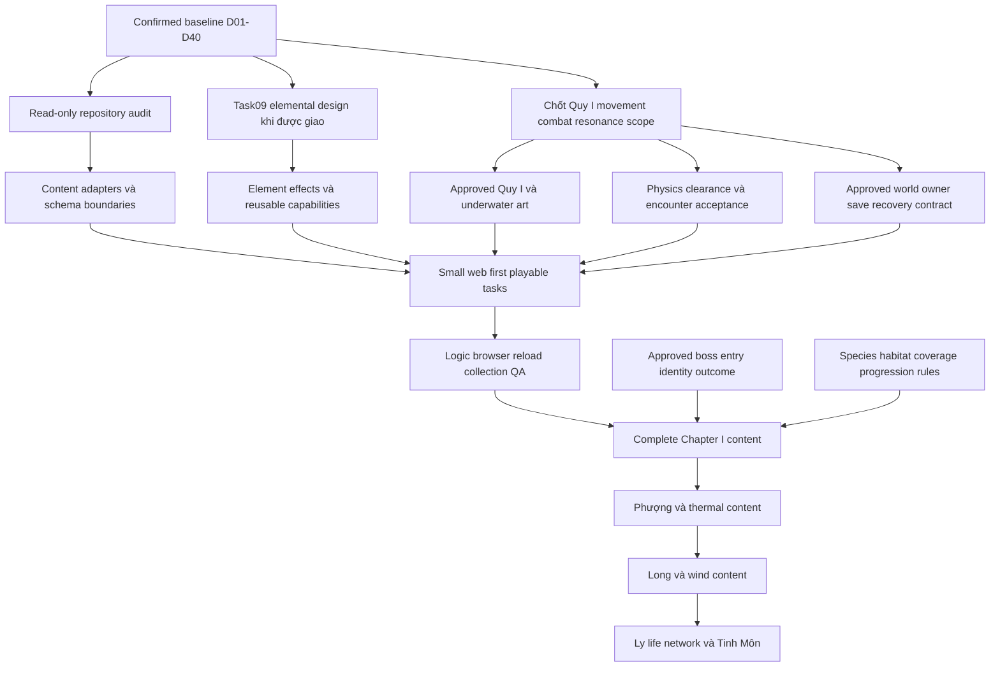

# Design và production dependency map

Task08, **PROPOSED sequence**, không roadmap implementation đã duyệt hoặc lịch cam kết. [Decision register](PROJECT_DECISIONS.md) thắng mọi giả định trong sơ đồ. Creative lore secrets không prerequisite ẩn của local mechanics.

Đồ thị này là dependency sản xuất, không thay [24-event story DAG](world/WORLD_EVENT_DEPENDENCIES.md). Task09 chưa bắt đầu. Không bắt toàn bộ elemental matrix hoặc optional faction/reputation để thử movement; scope nhỏ có thể chỉ cần subset đã approve của CAP. Không cycle mới: authority/body contract không đòi đã có playable build để được viết; prototype kiểm chứng assumptions rồi approval/update có version, không sửa facts âm thầm.

## Design cross-system edges

| Producer / nguồn | Consumer / dependency | Gate / risk / recovery |
| --- | --- | --- |
| D04/D18/D38 + [cosmology](lore/ELEMENTAL_COSMOLOGY.md) | Element classification, dual affinity, abilities, ecology | Life authority tách; Lôi/Kim foreign không evil; roster/interactions chưa final |
| [Life Core/Imprint](lore/LIFE_CORE_AND_IMPRINT.md) | Resonance/acquisition và form unlock | Physical B+C phải approve, không possession/resurrection ngầm; bootstrap không đòi Quy trước |
| [Resonance/progression](lore/RESONANCE_DECISION_RECORD.md) | Switch/loadout/combat/boss/save | Early boss conflict C08-01 trước boss; một body, per-form progression, frozen membership |
| [Creature stages/abilities](creatures/SACRED_EVOLUTION_MATRIX.md) | Art/movement/level gates/region receivers | Thresholds+clearance/clip requirements; main lesson trước capability gate, không optional evolution ẩn |
| [Story handoff](story/STORY_IMPLEMENTATION_HANDOFF.md) | World completion/quest/revelation/region phase | Parent/subgrant riêng, outcome không tự stable; 24 main dependencies acyclic |
| [Ecology templates](ecology/CREATURE_BEHAVIOR_CLASSIFICATION.md) | Habitat/encounter/reward rules | Species data/unique sources cần approve, nonlethal collection có đường phù hợp |
| [World authority](world/WORLD_STATE_ARCHITECTURE.md) | Save/quest/faction consumers/map presentation | Facts+owned mutable → projection; faction opinion không sửa physical ecosystem |
| [Habitat coverage](world/ECOLOGY_AND_SPAWN_STATES.md) | Restoration/variant/return path commit | Validate cả undiscovered, fallback viable; không có coverage thì defer/refuse patch |
| [Art register](ASSET_REFERENCE_REGISTER.md) | Runtime-ready catalog/animation/scene | Không Missing path giả, no clip no release gate; prototype không tự redesign approved reference |
| [Technical spec](technical/CREATURE_DATA_SPEC.md) + actual repo audit | Reusable content modules/loader/validator | D39 data-first, new mechanics có thể cần module; không fake generic runtime đã có |
| [Save contract](technical/PERSISTENT_WORLD_DATA_SPEC.md) | All durable grants/transitions/collection | Một commit/writer/ledger+recipient, migration và retry; không dùng UI key làm save gameplay |

## Giao diện entity không tạo authority thứ hai

| Term cũ / mới | Quan hệ nên dùng trong handoff | Cần validate trước schema |
| --- | --- | --- |
| creatureId / speciesId | Cùng logical identity như C04, không hai keys sửa độc lập | Uniqueness, formId/stageId refs |
| AncestralMemoryRecord / MemoryRecord | Tên đầy đủ Task03; W07 viết tắt, không store khác | Source/provenance/fragment/reward owner |
| EncounterDefinition / ConditionalEncounter | Nội dung encounter vs eligibility/presentation projection, outcome record riêng | Không duplicate completion/grant; final adapter map sau audit |
| RegionState / RegionEcologyState | Mutable owner vs derived ecology projection W07 | Stable flags/variant đọc từ owner; no independent enum |
| Global/ChapterProgressState / completion records | Read models vs immutable milestone facts | Available khác arrived; caches versioned, stale bỏ |

Đây là crosswalk **PROPOSED** để thống nhất thiết kế, không classes/JSON/code. Không chọn storage/library/engine qua tên entity.
