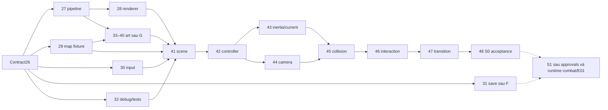

# Kế hoạch Task27–48: S0 trước S1

D26-01/02/03 **CONFIRMED**: S0 trước S1, Dawn mặc định, kiến trúc trước code. Thứ tự27–48 trong yêu cầu Task26 là nguồn số task hiện hành; supersede cách gán tạm của bảng kế hoạch Task25 **chỉ ở phạm vi mapping số task**, không sửa lịch sử hoặc đổi gameplay decisions. Đặc biệt42controller,43quán tính/current,44camera. Nội dung triển khai chi tiết dưới vẫn PROPOSED.

S0: scene quy-s0-test opt-in, QuyI, bơi/camera/solid/một current/một interaction/objective/restart; state tạm, không D40complete. S1: thêm cộng hưởng đúng D29, basic combat, durable progress/save safety/integration. S1 chưa bắt đầu khi HP/save/reward chưa được duyệt; full boss/collection/ending không mandatory của S0 hoặc D40.

Gate viết tắt: A scope đã duyệt D26-01; B plane/camera, C input/motion, D typed catalog, E HP/recovery, F persistence, G art/manifest, H sourcequest, I boss, J ending theo Task25. A không còn unresolved về S0-before-S1; cut chi tiết/acceptance vẫn cần review. B–J chưa được duyệt bởi Task26.

| Task / scope | Phụ thuộc / gate | Code hoặc asset dự kiến sau này | Test và rủi ro hồi quy | Acceptance tương lai |
| --- | --- | --- | --- | --- |
| 27 Asset pipeline | Contract26,G | Validator/load bundle/cache, không tái tạo art cũ | Missing path/rect/schema/digest; stale cache | Manifest lỗi bị chặn, Dawn vẫn load |
| 28 Pixel-art renderer |27,B/G | Render adapter/view, giữ IslandScene cũ | Anchor/DPR/layers/clip; crop Phượng | Sprite fixture đúng pixel, không đổi default |
| 29 Tilemap foundation |26,B/C | Map descriptor/test room policy riêng | Solid/water/return; global passability | Fixture nước không phá bờ Dawn |
| 30 Input architecture |26,C | Semantic/context/dispose adapter | Keys/touch/blur/remap; listener trùng | Phượng giữ controls, Quy actions chỉ opt-in |
| 31 Save/load foundation |26,D/F;E nếu payloadHP | Persistence port/adapter sau approval | Fault/crash/receipt/migration; mất save | Last-good/idempotency thực, không dùng UIsettings làm save |
| 32 Debug/test infrastructure |26/27 | Diagnostics fixtures/overlay nếu brief cho phép | Lifecycle refs/leaks/errors; overlay authority | Quan sát state không sửa progression |
| 33–40 Art production |27/29,B/D/G;34approval | Quy/underwater source/export/manifest riêng | Alpha/gutter/anchor/clip/readability; overwrite art | Kit S0 hợp lệ, không buộc II/III hoặc full wildlife |
| 41 ChapterI scene |28/29/30/32+kit33–40 | Scene factory/adapter/registration opt-in | Enter/exit/cancel/fallback; state reset | Dawn/sample giữ, một actor/loop |
| 42 Quy controller |41,C/D | Input→controller profile, fixture collision29 | Normalize/brake/basic pose; hover copy | QuyI điều khiển riêng, chưa tự approve số |
| 43 Inertia/currents |42,C | Velocity/current bounded composition | dt spike/wall/current/reverse; force lặp | Một current thấy và tác động được trong bounds |
| 44 Camera |41/42,B/G | Follow/clamp/envelope adapter | Resize/occlusion/edge; offset Phượng | Cue và cơ thể đọc được, pose không bị camera sửa |
| 45 Collision |29/42/43/44,C | Policy/sweeps/bounds/contacts | Góc/khe/return/longstep; nước Dawn | Không xuyên solid hoặc current đẩy ra map |
| 46 Interactions |41/45+cuekit | Receiver+objective tạm | Duplicate/restart/feedback; fake E05 | Một before/after và mục tiêu có điều kiện rõ |
| 47 Scene transitions |41/45/46 | Preload/teardown/swap/fallback | Late callbacks/double enter/dispose throw | Về Dawn an toàn, không coi local swap là E06 |
| 48 First playable sample |27–30/32/41–47+kit | Sample build/acceptance fixtures | Full default/sample/opt-in browser smoke | S0đạt checklist; S1/D40chưa đạt nếu thiếu combat/resonance/durable |

Chi tiết phân công33–40 dưới đây là scope đề xuất trong đúng dải art production, không nhận là tên đề bài chính thức. Khi brief thật khác phải reconcile trước sản xuất. Basic combat clip của S1 không trở thành dependency S0.

| Task | Scope đề xuất / thay đổi | Phụ thuộc/gate | Test/rủi ro | Acceptance |
| --- | --- | --- | --- | --- |
| 33 | Brief/source art Quy và môi trường |27/29,B/G | Provenance/scale; dùng sai reference | Nguồn/hướng được duyệt trước export |
| 34 | Anatomy/anchor/sprite contract QuyI |33,D/G/B | ID/footprint; nhầm stage/ability | Approved reference/manifest binding, không chốt cell96 ngầm |
| 35 | Idle/swim directions |34 | Alpha/directions; mirror sai anatomy | Clips bơi đọc rõ ở scale gameplay |
| 36 | Turn/brake/interact |34,C | Anchor/bao hình; sprite lệch motion | Cùng basis và clear feedback |
| 37 | Clip hành động bổ sung theo scope được duyệt |34,E/G nếu combat | Marker/contact; idle giả tấn công | Validation riêng cho S1, không chặn S0 khi chưa cần combat |
| 38 | Terrain/solid/water kit nhỏ |29/33,G | Edge/collision association; overwrite Dawn | Bộ thử nước có semantic tile phù hợp |
| 39 | Current/receiver/landmark cues |29/33,C/G | FXoff/muted; chỉ màu không đọc được | Cue quan trọng luôn có trong S0 |
| 40 | Kiểm export/atlas/bundle integration |27/35/36/38/39,28 | Rect/gutter/clip/paths; resource thiếu | Kit S0ready;37 kiểm riêng khi S1 cần |

Các đầu vào vào node là AllOf, không AnyOf.29có minimal solver fixture để42thử;45là integration/hardening, không vòng42↔45.27/29/30/32 có thể song song sau contracts;31tách lane sauF không chặn S0; art sauG có thể song song input. Đây không lệnh chạy task song song ngay. Runtime thay sớm nhất từ27nếu brief cho phép, **không thay trong26**. Trước49phải duyệt E/F và reward/source scope của S1, không suy48PASS là D40PASS.
