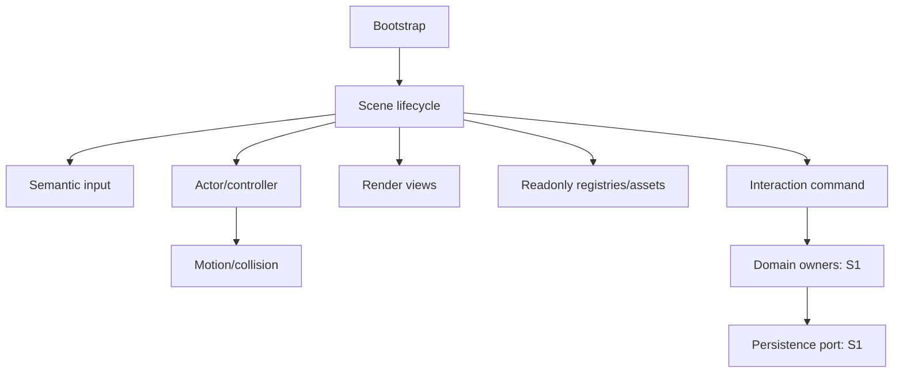

# Kiến trúc runtime tăng dần

Baseline ngày01/11/2026: work tại4dd014bf161e548d50b724df15934de26a960400, cây sạch. Task25 đã push bình thường từ1bae0846 lên4dd014bf, kiểm trực tiếp origin/work; main vẫn5ad5678d1fc8b991c0a35d1ffd80f3e816e8624d. Không dispatch workflow. Đã rà14tài liệu [Task25](../technical/TASK25_REPOSITORY_AUDIT.md) và đọc lại main/GameState/InputManager/islands/workflow; nguồn actor/render/collision/asset theo audit tương ứng. Quan sát: Canvas2D,23module, dawn/dawn-sample, GameState tạo PlayerPhoenix, settings có lưu nhưng chưa game-save writer. Các interface sau chỉ là đặc tả, không mã đang tồn tại.

## So sánh chiến lược

| Chiến lược | Tái dùng / công sức | Hồi quy / kiểm thử | Hiệu năng / mở rộng / bảo trì | Tương thích và giao tăng dần |
| --- | --- | --- | --- | --- |
| A bổ sung | Cao/thấp nhất ban đầu | Dễ giữ test cũ, rủi ro lớp bọc phình | Ít overhead nếu interface nhỏ; hardcode còn cần xử lý | Tốt, scene opt-in trước |
| B trích core từng phần | Cao/trung bình | Cần test tương đương từng extraction | Ranh giới sạch hơn, chi phí chuyển đổi có kiểm soát | Tốt nếu adapter giữ hành vi |
| C viết lại engine | Thấp/cao | Mất baseline, nhiều test lại | Chưa bằng chứng cải thiện FPS; framework mới tăng nợ | Kém, khó bàn giao nhỏ |

Khuyến nghị A kết hợp B có chọn lọc **PROPOSED ADR-26-04**; C không có chứng cứ đủ hoặc approval. D26-01/02/03 là CONFIRMED do yêu cầu Task26, không phê duyệt plane/HP/catalog/art.

## Ranh giới và interface đề xuất

| Miền / mục đích | Interface khái niệm | State duy nhất / phụ thuộc / vòng đời | Test / phần prototype giữ / mốc sớm |
| --- | --- | --- | --- |
| Bootstrap khởi động | boot, selectScene, tick, reportError | Sở hữu loop và active scene handle; tạo services, không domain progression | Boot failure/one-loop; main hiện hữu qua adapter; S0 nền |
| Scene điều phối | load/enter/update/render/exit/dispose | Scene entities/camera/local state; nhận services, không import bootstrap | Lifecycle/race/cleanup; Dawn renderer không thay; S0 |
| Actor danh tính/thân | spawn, activate, deactivate, readView, dispose | Pose/motion của instance, catalog readonly; không own XP/slot | Hai species fixture; PlayerPhoenix giữ; S0 adapter |
| Input thiết bị | sampleActions, clear, setContext, dispose | Held/pointer/edge queues; DOM→semantic action, không import actor cụ thể | Blur/remap/cancel; phím Phượng cũ; Task30 |
| Movement | proposeMotion, resolveMotion | Controller giữ velocity; profile/current readonly, collision nhận intent | Current+wall/timestep; policy đất Phượng giữ;42–45 |
| Render | drawScene, drawActor, readClip | Cache/view readonly, camera transform; không ghi gameplay | Anchors/pixel/culling; IslandScene cũ;28 |
| Assets | loadBundle, validate, release | Cache/refcount theo bundle; registry readonly, báo lỗi required | Missing/abort/cache; manifest Dawn giữ;27 |
| Interaction | query, requestInteraction, readResult | Local scene writer S0; S1 gửi command tới domain owner | Duplicate/restart; shrine cũ không đổi;46 |
| Combat tương lai | requestAction, resolveHit, readCombatView | Action/health/status theo owner C14/E09/L16; chưa chọn HP | Hit/HP0/ordering; SkillSystem Phượng giữ; S1 |
| Progression | readSpeciesProgress, requestUnlock | P15/V13/R03 sở hữu EXP/skill/stage, không actor/view | No regrant/typed refs; chưa prototype tương ứng; S1/sau |
| Quest | evaluateObjectives, readQuestProjection | Đọc evidence/event owners, không completion store mới | Prior proof/optional independence; S1/sau |
| Persistence | loadValidated, commitCandidate, lookupReceipt | W07 writer tương lai, schema/receipt owners; không adapter đã chọn | Crash/quota/migration; UISettings tách;31 sau duyệt |

Không tạo ngay12file JS hay ECS theo12hàng này. Nhóm các trách nhiệm nhỏ trong module hiện hữu qua adapter trước; chỉ trích khi scene Quy thật cần. Bootstrap phụ thuộc contract/service; scene phụ thuộc input/assets/world/actor; controller phụ thuộc math/collision; renderer chỉ đọc views. Domain không import DOM/Canvas/scene loader hoặc concrete storage. Persistent command qua một writer, không event bus ghi tùy ý.

Chỉ mục: [scene](SCENE_LIFECYCLE_CONTRACT.md), [Phượng](PHOENIX_COMPATIBILITY_STRATEGY.md), [actor](ACTOR_AND_CREATURE_INTERFACES.md), [input](INPUT_ACTION_ARCHITECTURE.md), [motion](MOVEMENT_AND_COLLISION_BOUNDARIES.md), [render](RENDERER_AND_ANIMATION_CONTRACTS.md), [registry](CONTENT_REGISTRY_ARCHITECTURE.md), [ownership](STATE_OWNERSHIP_MATRIX.md), [save](PERSISTENCE_INTERFACE_BOUNDARY.md), [combat](COMBAT_INTEGRATION_BOUNDARY.md), [quest](QUEST_WORLD_STATE_INTEGRATION.md), [tests/release](TESTING_AND_RELEASE_STRATEGY.md), [roadmap](FIRST_PLAYABLE_ENGINEERING_PLAN.md), [ADR](TASK26_ARCHITECTURE_DECISIONS.md), [audit](TASK26_TECHNICAL_CONSISTENCY_AUDIT.md).
