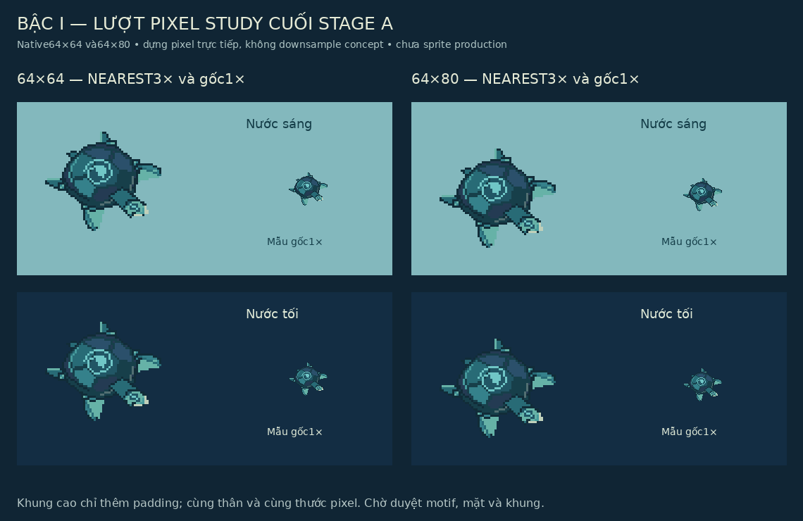
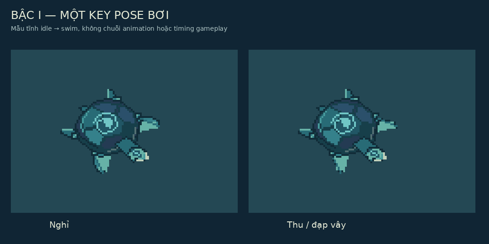
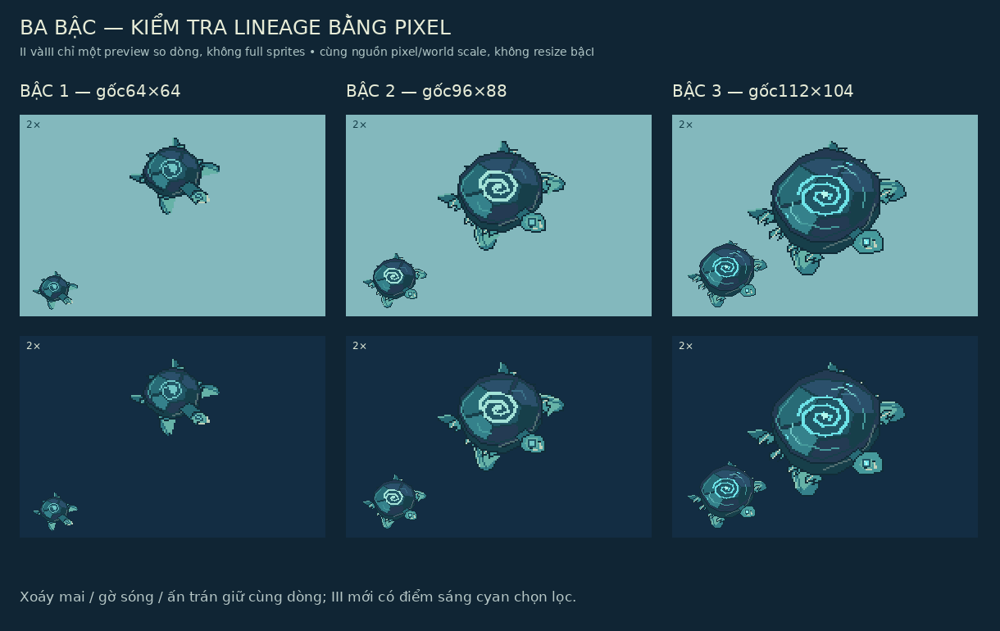

# Task34 Stage A — lượt pixel study cuối để duyệt

01/11/2026 (Asia/Saigon). Baseline work **7d1916450154398ddbbe0cc426bad8561c4006e0**, sạch trước chỉnh; origin/work đã kiểm cùng SHA, origin/main **5ad5678d1fc8b991c0a35d1ffd80f3e816e8624d**. Chỉ StageA, không Task34B/StageB, atlas, full animation hoặc runtime integration.

## Phê duyệt đã nhận và master ưu tiên

**CONFIRMED_IN_PRINCIPLE:** người dùng đã duyệt hướng concept ba bậc và chọn **bộ ảnh thứ hai** làm master ưu tiên vìI gọn, chừa trần phát triển. Tệp được định danh là [comparison R2](../../assets/concepts/quy-stage1/task34-stage-a/revision-2/lineage-concept-comparison.png),1942×809, SHA256 `4d781febf6009ea8e47c29e54a3c236e7d70b98de878e26dcf0ae7ba4595aec3`. Không tạo concept master mới hoặc lẫn với ảnhI nhiều trang trí ở lượt trước.

Đây là phê duyệt **định hướng concept**, không production-ready sprite, không chốt từng pixel/màu/khung/mirror và không cho phép StageB. Yêu cầu có ba signature xuyên dòng tiếp tục **CONFIRMED**: xoáy Thủy giữa mai, viền sóng riêng, dấu Thủy trán. **PROPOSED / PIXEL_STUDY_PENDING_APPROVAL:** mọi hình pixel của lượt này. **UNRESOLVED:** hình cuối/khung/clip anatomy cho sản xuất. **SUPERSEDED:** không tự đổi nhãn các proposalR1/R2 thành từng được duyệt; giữ làm lịch sử.

Nguồn: chỉ dẫn người dùng mới nhất, [reviewR2](TASK34_STAGE_A_REVISION2_REVIEW.md), [Art Bible](ART_BIBLE_MASTER.md), [scale](PIXEL_DENSITY_AND_SCALE.md), [hướng](EIGHT_DIRECTION_ANIMATION_STANDARDS.md), [manifest27](../technical/TASK27_MANIFEST_CONTRACT.md), [renderer28](../technical/TASK28_PIXEL_SCALING.md). Không tái audit01–33; các gate HP/receipts/gameplay/production loader trong [audit](../reviews/POST_TASK33_COMPREHENSIVE_AUDIT.md) giữ nguyên.

## PixelI thật ở64×64 và64×80

[64×64 SE](../../assets/concepts/quy-stage1/task34-stage-a/final-pixel-pass/stage1-se-64x64.png), [64×80 SE](../../assets/concepts/quy-stage1/task34-stage-a/final-pixel-pass/stage1-se-64x80.png), [64×64 S](../../assets/concepts/quy-stage1/task34-stage-a/final-pixel-pass/stage1-s-64x64.png) được dựng trực tiếp từ polygon/line theo tọa độ native; không đọc, downsample, pixelate hoặc lấy các sprite nhỏ trong master. [Source](../../assets/concepts/quy-stage1/task34-stage-a/final-pixel-pass/build_studies.py) là công cụ art phi sản xuất, không mã ứng dụng. Bảng mới phóng nguyên lần bằng NEAREST, có1× thật; pixel trong study không được tăng chi tiết bằng upscale.

Cùng body/pose SE và thước pixel giữa hai khung;64×80 thêm8px phía trên/dưới, không làm cơ thể lớn hơn. Neo đề xuất [32,32] và [32,40]; boundsSE lần lượt [6,10,61,57] và [6,18,61,65], right/bottom exclusive. Đây là visual bounds đo alpha, không collision footprint/hurtbox/hitbox. Số khung không phải kích thước thân của một stage.

| Ưu tiên | Cách xử lý trong pixelI | Đánh giá/giới hạn còn lại |
| --- | --- | --- |
| Xoáy mai | Nét xoắn sáng ngọc đục trên phiến trung tâm tối, không halo | Nhận được ở1×; hình học motif cụ thể vẫn cần duyệt |
| Viền riêng | Hai cặp gờ sóng thấp nối vào mai, giữ mai gọn | Cần retouch một số cạnh bậc thang/gốc gờ trước sản xuất, không thêm gai lớn |
| Mặt cổ xưa | Đầu nêm gọn, mắt ít pixel, dấu trán nhỏ, jaw ngà tiết chế | Số pixel mặt hạn chế, không đủ kết luận đã truyền đạt trọn thần thái master; tránh chibi khi refine |
| Vây trước | Tách mặt vây và hướng thu/đạp, maiI gọn lại để lộ vây | Vẫn cần anatomy/pose review ở1× và nhiều nền scene; không tăng collider để khớp hình |
| Readability | Nền nước sáng/tối, silhouette tối và điểm nhận diện sáng | Mép tối vẫn nhập nước sâu ở vài đoạn; chỉ nên chỉnh value cạnh có chọn lọc, không bù bằng glow toàn thân |

**PROPOSED:** giữ64×64 làm ứng viên gọn;64×80 nếu vòng animation sau cần khoảng dư. Cả hai chứa các pose hiện có và đủ2px đệm thăm dò; chưa chọn khung cuối. Chưa kiểm8 hướng/animation đầy đủ của geometry mới; study8 hướngR2 là lịch sử hỗ trợ kế hoạch, không bằng chứng cả8 clip của lượt này đã được vẽ.

## Một key pose bơi, chưa animation

[Swim key64×80](../../assets/concepts/quy-stage1/task34-stage-a/final-pixel-pass/stage1-swim-key-64x80.png) thay tọa độ đầu vây có chủ đích, giữ cùng neo/body scale; không lấy ảnhidle kéo giãn hoặc làm full loop. Phản hồi cuối vẫn theo scope idle/swim/turn/brake/interaction đã duyệt, nhưng pass này chỉ có pose tĩnhS/SE và một swim key. Không timing, attack/dodge/i-frame, source marker hoặc runtime controller mới.

## PreviewII/III chỉ kiểm lineage

| Study | Native preview / bounds | Khác cấu trúc và signature |
| --- | --- | --- |
| I |64×64 SE, bounds55×47px nhìn thấy | Mai thấp/gọn, hai cặp gờ nhẹ,12 màu đục được dùng; xoáy và dấu trán đủ nhận diện, chưa toàn thức tỉnh |
| II |[96×88](../../assets/concepts/quy-stage1/task34-stage-a/final-pixel-pass/stage2-lineage-preview.png), bounds78×67px nhìn thấy | Vai/vây, cổ/mai có tọa độ phát triển riêng, ba cặp viền và kênh bên; cùng chiều xoáy/ấn,15 màu được dùng |
| III |[112×104](../../assets/concepts/quy-stage1/task34-stage-a/final-pixel-pass/stage3-lineage-preview.png), bounds97×82px nhìn thấy | Mai nhiều mặt lực và lớp dày hơn, bốn cặp viền, rãnh phụ; điểm cyan chọn lọc ở xoáy/ấn/mép,16 màu được dùng |

II/III chỉ **một pose SE mỗi bậc** để so khối/anatomy/signature, không đầy đủ sprites hoặc bộ hướng. Không dùng resize/recolorI: source có các mốc shell/head/front/rear/rim riêng cho từng bậc và các đường motif phát triển, không chỉ nhân một hệ số. Trong bảng tất cả dùng chung2× để so kích thước tương đối, có1×; không normalize từng bậc cho bằng nhau.

96×88 và112×104 là canvas thăm dò, **không frame production được duyệt**. Các preview còn là blocking hình khối bằng mã, chưa đạt mức tinh tế/uy nghi của concept master; không lấy chúng thay duyệt anatomyII/III. Các điểm sángIII là màu pixel sáng được đề xuất, không shader hoặc skill/authority mới. I vẫn Sacred từ đầu chứ không rùa thường đổi loài ởIII.

## Phân biệt ba mức và validation thực

| Mức | Trạng thái |
| --- | --- |
| Concept art | MasterR2 được duyệt về nguyên tắc, giữ nguyên tệp/họ hình |
| Pixel study |6 native PNG tĩnh và3 bảng xem mới, chờ duyệt cách chuyển concept thành pixel |
| Production-ready sprite | **Chưa có**, chưa atlas, full animation, export contract/catalog/runtime integration hoặc production visual QA |

Kiểm mới cho pass này:9 PNG đọc được;6 nativeRGBA có alpha0/255,12–16 màu đục thực dùng, bounds nằm trong khung với2px đệm thăm dò và không cắt đầu/vây. Fixture validator27 đạt6 ảnh (0error/0warning), chỉ kiểm PNG/rect/anchor/bounds, không duyệt creative hoặc đánh dấu scene-ready. Production validator giữ9PNG cũ PASS. Rebuild giữ nguyên hash9PNG;58 liên kết hợp lệ, bảng/fence và git diff --check đạt.683 tệp tracked ngoài phạm vi, gồm115 PNG cũ, giữ nguyên; không sửa master đã chọn. Không chạy gameplay/browser regression mới vì runtime không đổi; bằng chứng202 Node/38 IndexedDB của audit là kế thừa, không kết quả pass này.

Chưa physicalmobile, in-engine scale/camera/occlusion, full8-direction coverage hoặc playback. Ảnh nền là mẫu sáng/tối tổng hợp, không map production. Chỉ thực hiện những kiểm tra được ghi ở đây, không dùng script exit0 thay visual review.

## Những gì cần duyệt ở lượt pixel này

Không hỏi lại hướng lineage đã duyệt về nguyên tắc. Cần phản hồi về **cách chuyển sang pixel**: độ rõ xoáy/gờ/ấn; nét mặt và vây ở1×; palette/value trên hai nền; khung64×64 hay64×80; previewII/III có giữ cùng dòng và đúng khoảng phát triển không. Các bản này còn là đề xuất có thể yêu cầu retouch.

Dừng sau StageA pixel-study pass theo yêu cầu. Không coi việc commit hoặc duyệt một mục là cho phép Task34B. Không tự bắt đầu atlas, full animation, runtime integration, StageB hoặc Task35.
