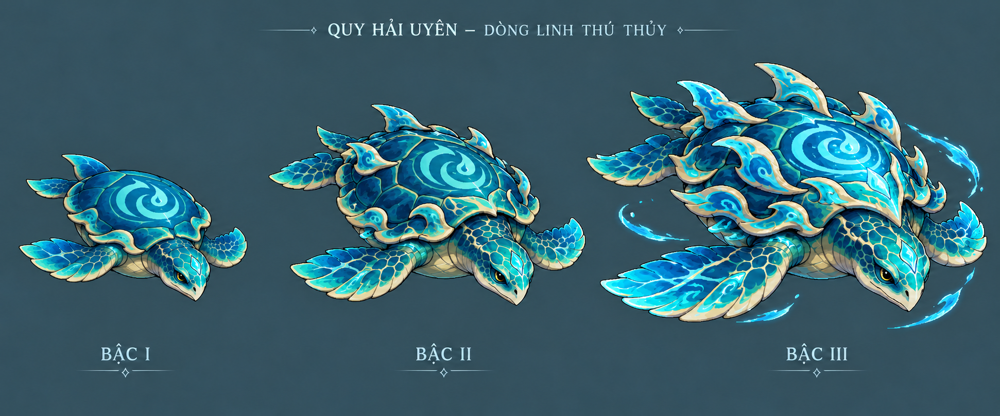
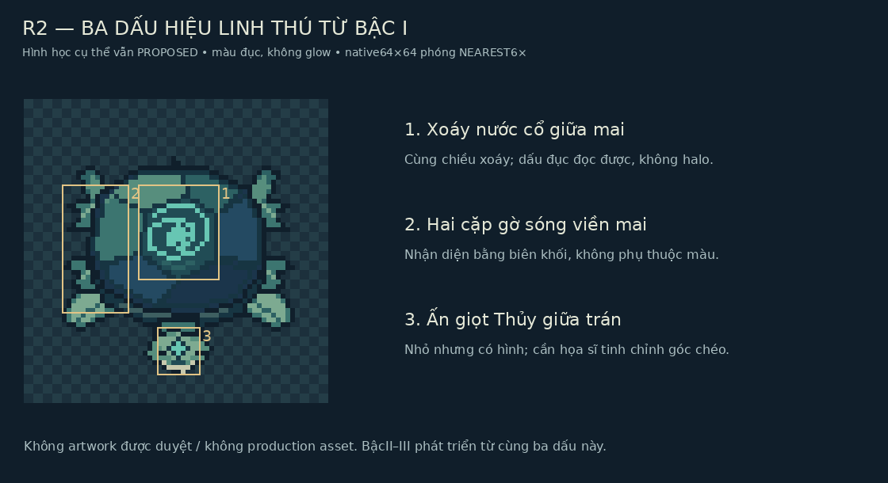
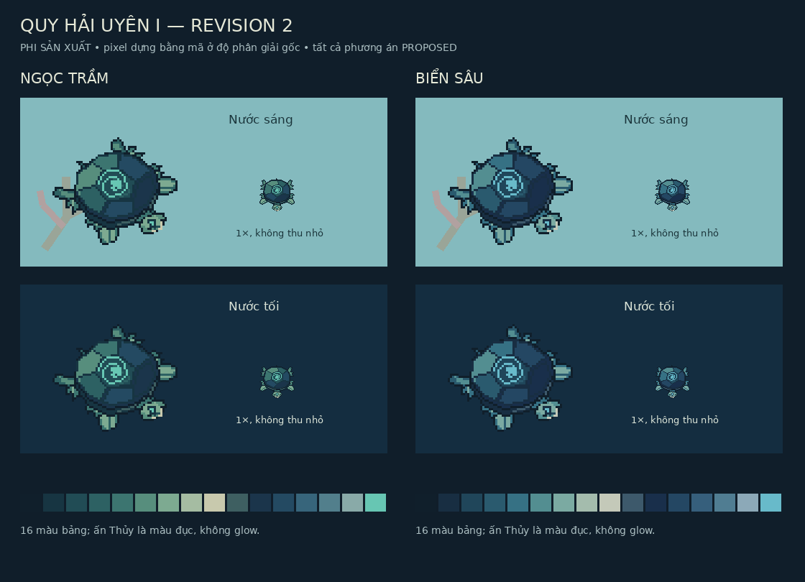
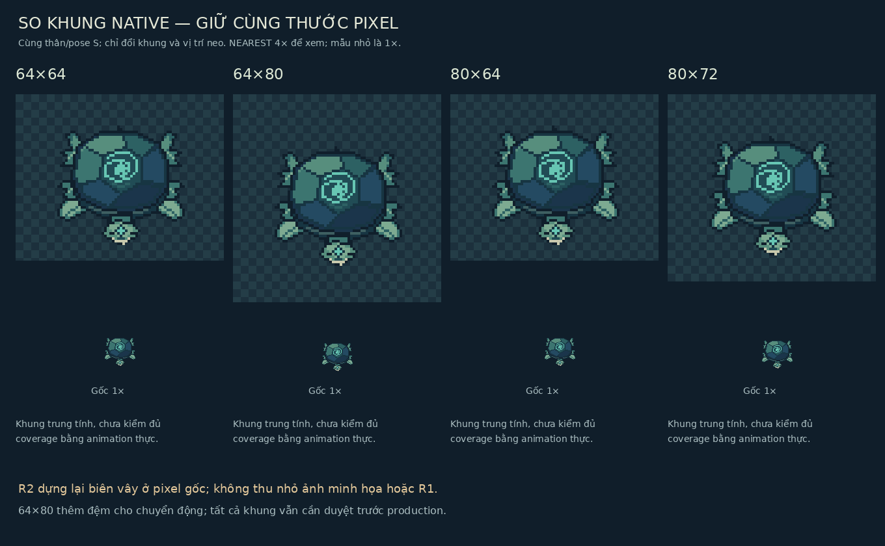
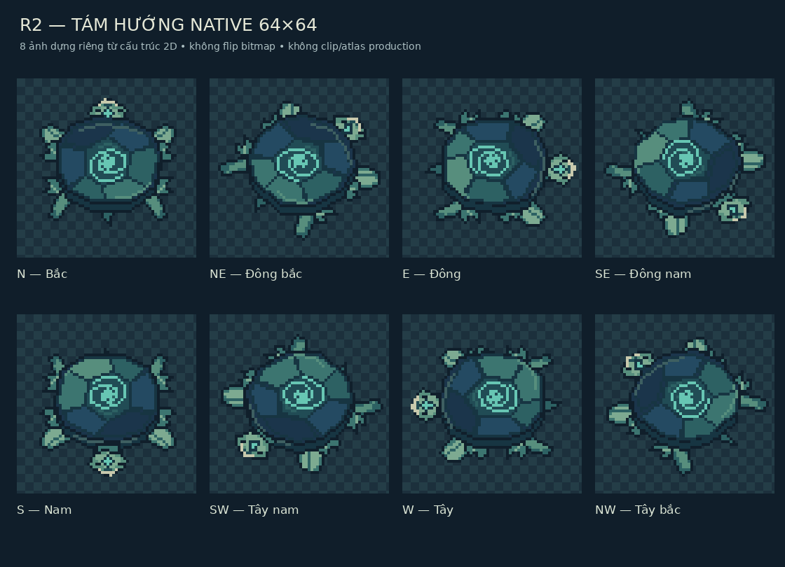
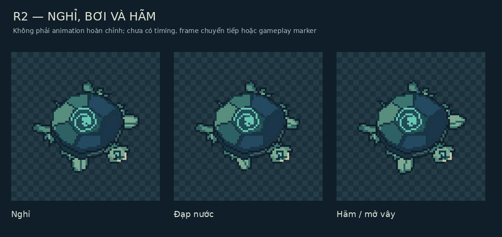

# Task34 Stage A — Revision2: cùng một dòng Linh Quy qua ba bậc

01/11/2026 (Asia/Saigon). **READY_FOR_USER_REVIEW**, chưa duyệt hình cuối/StageB. Baseline audit b2c84c1943dd22c04e43ed29deed15dd9902ee3b trên work đã được kiểm trên origin/work. [Audit](../reviews/POST_TASK33_COMPREHENSIVE_AUDIT.md) cho phép StageA; không mở lại audit01–33. Bản đầu được giữ để đối chiếu, R2 là gói hình hiện hành.

## Phạm vi được giao và trạng thái

**CONFIRMED — yêu cầu người dùng:** cảI/II/III đều là cùng linh thú cổ, không I là rùa thường rồiIII mới thiêng; cùng dấu xoáy giữa mai, viền mai riêng và ấn Thủy trán. I nhỏ/đơn giản/ít glow, II lớn/cấu trúc phát triển, III uy nghi nhất và có thể có vùng sáng kiểm soát. **PROPOSED:** hình học cụ thể của ba signature trong gói này, palette, tỷ lệ, pixel clusters, pose và khung. **UNRESOLVED:** phê duyệt bằng hình và công việc StageB. **SUPERSEDED:** không tự thay nhãn các proposal cũ; R1 là lịch sử nghiên cứu, không canon từng được chấp nhận.

Nguồn: hình tham khảo đính kèm trong tin nhắn Revision2 và chỉ dẫn đi cùng; [Art Bible](ART_BIBLE_MASTER.md), [brief Quy](QUY_STAGE1_TASK34_HANDOFF.md), [pixel contract](PIXEL_DENSITY_AND_SCALE.md), [direction](EIGHT_DIRECTION_ANIMATION_STANDARDS.md). Hình người dùng được xem trực tiếp trong hội thoại; chưa có file local/provenance/license để đăng ký. Các nhãn64×64/chuỗi6frame trên hình chỉ là nội dung tham khảo, không metadata/raw sprite đã được xác minh. Không copy chúng hoặc pixelate ảnh đó thành sprite.

## Concept nguyên bản cho cả ba bậc

[Ảnh concept1942×809](../../assets/concepts/quy-stage1/task34-stage-a/revision-2/lineage-concept-comparison.png) được tạo mới bằng image generation, dùng reference trong hội thoại làm định hướng và một lượt chỉnh giảm trang tríI. Cả ba có cùng hướng đầu/rùa biển, xoáy ôm giọt cùng chiều, gờ viền sóng và dấu trán; II/III phát triển phiến mai/vây/khối thân, không bản I resize hoặc recolor. Đây là **minh họa concept RGB trên nền trình bày**, không native pixel, không model sheet production, không có spriteII/III mới.

| Bậc | Signature xuyên lineage | Phần tăng trưởng / giới hạn |
| --- | --- | --- |
| I | Xoáy chạm ngọc giữa mai, gờ sóng thấp, giọt trán nhỏ | Linh tính nhận ra ngay; không cần halo/gai/crown hoặc dùng hết ornament của dòng |
| II | Giữ nguyên gốc xoáy/viền/ấn, nét và hình khối phát triển | Mai/vai/vây trưởng thành, gờ sóng rõ hơn; anatomy lớn và tinh luyện, không chỉ thêm màu vàng |
| III | Signature tinh luyện và uy nghi nhất, một số vùng cyan sáng | Thân/mai có tầng dẫn dòng, điểm sáng chọn lọc; không phủ FX lên đầu/thân hoặc chuyển hệ Kim/Thổ |

**Giới hạn cần duyệt:** conceptI vẫn có các vệt ngà và texture nhiều hơn native; viền trongII/III còn khá trang trí. Không tự giữ mọi chi tiết vào sprite; ấn/xoáy cụ thể chưa được người dùng chấp nhận. Màu sáng trênI là đề xuất inlay/mặt vật liệu, không quyết định gameplay phát sáng. ChỉIII có đề xuất hiệu ứng Thủy bên ngoài ở concept, không runtime FX được triển khai.

## Ba signature ở độ phân giải gốc

[Source pixel R2](../../assets/concepts/quy-stage1/task34-stage-a/revision-2/build_pixel_studies.py) dựng lại polygon/mảng màu trực tiếp trên lưới pixel, kế thừa công cụ nghiên cứuR1 nhưng đổi tọa độ vây/đầu/viền và thêm hình xoáy/ấn. Không đọc/downsample concept hoặc ảnh tham khảo. Không phải pixel art đã được họa sĩ hoàn thiện từng frame.

- Xoáy: đường xoắn mở ôm giọt, mảng màu đục có tương phản giữa mai; giữ chiều xoáy khi dựng hướng, không mirror ảnh.
- Viền: hai cặp gờ sóng gắn cùng gốc mai; đọc qua silhouette, không phụ thuộc chi tiết màu li ti. BậcI chỉ vài gờ thấp; II/III có thể tăng tầng từ chính những điểm gốc.
- Trán: hình giọt nhỏ trên đầu; đây là signature đề xuất, không vật phẩm/skill/element mới. Ở góc chéo rất ít pixel nên còn cần retouch và user review.

Pixel study vẫn còn góc cạnh ở gờ sóng, đầu/mắt/cổ chưa tinh tế; cùng cấu trúc2D dựng hướng không thay việc vẽ anatomy đúng mặt bên. Kiểm này cho thấy có hình nhận diện để duyệt, không chứng minh đã đạt chất lượng final fantasy pixel art.

## So palette và khung I

Hai palette cùng họ jade/deep-ocean, tối đa16 màu đục, không halo trong native. Ngọc trầm làm signature ấm/ngọc hơn; Biển sâu xanh lam hơn và dễ nhập nền tối ở mép ngoài. Đề xuất tiếp tục Ngọc trầm nhưng **chưa chọn thay người dùng**. Nước sáng/tối là nền mẫu tổng hợp, không production map; cần scene/máy thật sau duyệt.

[64×64 gốc](../../assets/concepts/quy-stage1/task34-stage-a/revision-2/pixel-jade-64x64.png) và [64×80 gốc](../../assets/concepts/quy-stage1/task34-stage-a/revision-2/pixel-jade-64x80.png) chứa cùng body/đơn vị pixel, chỉ thêm8px đệm trên/dưới ở khung cao. R2 **vẽ lại biên vây và đầu**, không scale ảnhR1.24 trường hợp tĩnh8 hướng×3 pose đều đủ2px đệm thăm dò ở64×64 và64×80; không crop.80×64/80×72/80×80 chỉ là đối chứng kỹ thuật cùng geometry, không khung bắt buộc.

Khuyến nghị **PROPOSED:**64×64 là ứng viên gọn sau R2;64×80 nếu cần dư chỗ cho extrema animation về sau. Không lấy24 pose tĩnh làm bảo đảm mọi frame/độ mở vây cuối; không tự chọn khung cuối hoặc collision/hurtbox. [Số đo](../../assets/concepts/quy-stage1/task34-stage-a/revision-2/study-measurements.json) giữ từng trường hợp; số R1 thiếu khung64 là lịch sử, không kết quả R2.

Anchor đề xuất64×64 [32,32],64×80 [32,40]; visual bounds đọc từ alpha thật, tách collision/hurt/attack geometry. PNG/rect/anchor/bounds hợp [manifest27](../technical/TASK27_MANIFEST_CONTRACT.md); direction/fallback không tự là field schema production. Không tạo atlas/đăng ký manifest, không dùng ảnh concept RGB làm actor.

## Key pose bơi và phương án tám hướng

Có8 tệp direction-n/ne/e/se/s/sw/w/nw-64x64.png thực trong thư mụcR2. Chúng là keypose studies, **không8 bộ animation**. Gốc chi/ấn trán ở hướng chéo cần duyệt lại; không mirroring nào được cho phép chỉ vì đã có ảnh. Movement và attack-facing vẫn tách về khái niệm.

[Mẫu pose bơi64×80](../../assets/concepts/quy-stage1/task34-stage-a/revision-2/pose-swim-64x80.png) là một tư thế thu/đạp vây đề xuất, cùng neo với idle và brake. Không chuỗi6frame, không timing/combat/dodge/hitbox mới. Kế hoạch vẫn năm nhóm idle/swim/turn/brake/interaction; ưu tiên8 hướng swim rồi idle. Turn/interaction và frame chuyển tiếp chưa được vẽ đầy đủ; frame-count96 ởR1 chỉ estimate chưa approved, không tự thành quotaR2.

## Phân biệt mức sẵn sàng và QA

| Loại | Có thật ở R2 | Chưa được suy |
| --- | --- | --- |
| Concept |1 minh họa nguyên bản so cả3 bậc | Không raw sprites/stageII/III production hoặc approved lineage |
| Native pixel study |17 ảnh RGBA nhỏ:6 frame/palette,8 hướng,2 pose,1 silhouette | Không animation/atlas hoàn chỉnh, chưa đạt art production QA |
| Bảng trình bày |7 boards: palette/scale/directions/silhouette/motion/mobile/signature | Không screenshot game hoặc physicalmobile test |
| Production asset | **Không có asset production mới** | Không runtime loader/catalog/form/scene registration |

Validation mới R2:25 PNG đọc được;17 native/mask có alpha0/255 và một khối liên thông8-neighbor,16 ảnh màu tối đa16 màu và đạt fixture validator27 (0error/0warning).24case/khung ở cả5 khung đối chứng đủ khoảng đệm2px thăm dò.114 liên kết hợp lệ, bảng/fence và git diff --check đạt; rebuild giữ nguyên hash25 PNG.651 tệp tracked ngoài phạm viR2, gồm90 PNG (66 production/lịch sử cũ và24 hìnhR1), được giữ nguyên. Production validator vẫn đạt9 PNG cũ. Không test gameplay mới vì runtime không đổi. Bằng chứng audit202 Node/38 IndexedDB là kế thừa, không kết quảR2. GóiR1 được giữ; mọi hìnhR2 **PENDING_USER_APPROVAL**. Dừng ở [phiếu duyệtR2](TASK34_STAGE_A_REVISION2_APPROVAL.md), không StageB hoặc Task35.
