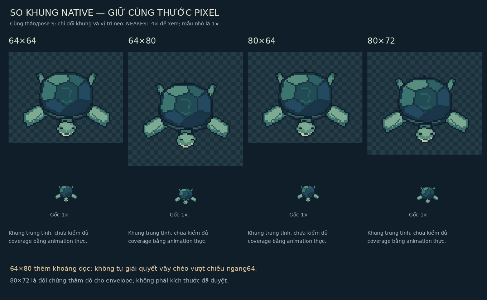
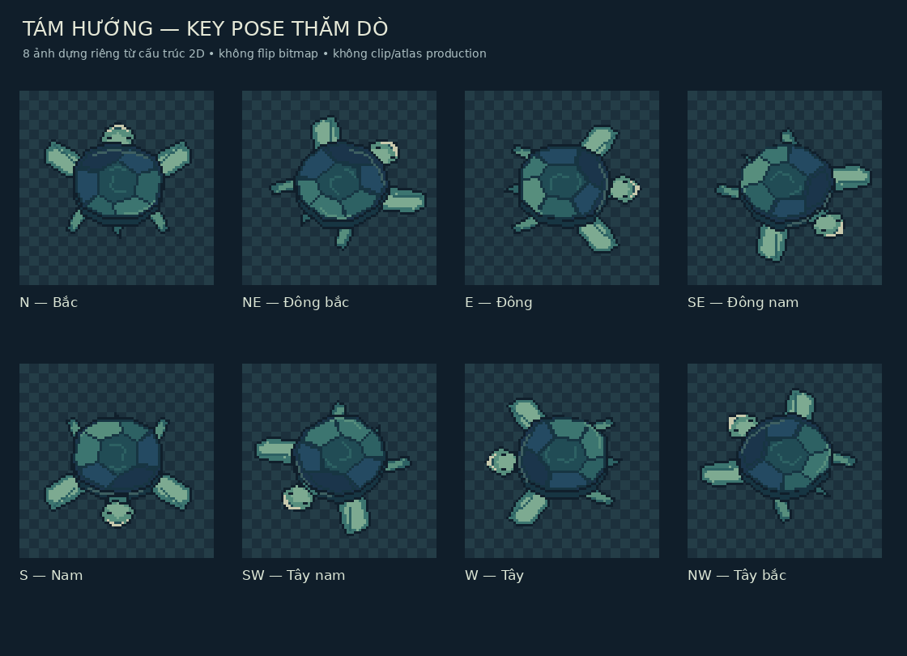
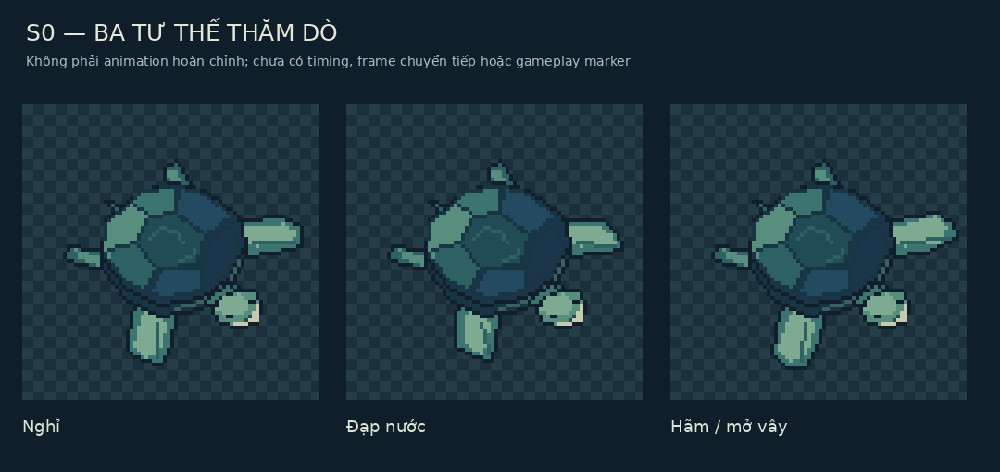

# Task34 Stage A — khung pixel, hướng và kế hoạch animation

**Bản nghiên cứu R1 được giữ làm lịch sử.** Gói hiện hành theo phản hồi người dùng là [Revision2](TASK34_STAGE_A_REVISION2_REVIEW.md), bổ sung linh tính xuyên ba bậc và số đo native mới; không coi R1 hoặc R2 là hình đã được duyệt.

**CONFIRMED:** so64×64/64×80; hỗ trợ hướng tới8 hướng, năm nhóm S0 idle/swim/turn/brake/interaction. **PROPOSED:**2px khoảng đệm thăm dò, khung đối chứng và mọi số frame bên dưới. **UNRESOLVED:** khung cuối, mirror/fallback, timing và sản xuất. **SUPERSEDED:** không đổi lịch sử nguồn. Xem [review hình](TASK34_STAGE_A_VISUAL_REVIEW.md), [pixel contract28](../technical/TASK28_PIXEL_SCALING.md), [manifest27](../technical/TASK27_MANIFEST_CONTRACT.md).

## Cách dựng và đo

[Source vẽ](../../assets/concepts/quy-stage1/task34-stage-a/build_pixel_studies.py) dùng Pillow/ImageDraw polygon/line trực tiếp trên lưới; không mở concept-illustration để tạo sprite. Bảng phóng nguyên lần dùng NEAREST, không blur/automatic pixelation. Khung64×64 và64×80 chứa **cùng geometry, cùng source-pixel scale**; neo thân ở tâm khung, thêm8px trên/dưới khi tăng chiều cao. Không làm thân lớn hơn để lấp khung.

Tư thế mẫu S và SE, cùng idle/swim/brake đã được kiểm bằng alpha bounds trên canvas dư160×160. Với mỗi khung thử, dịch cùng neo về tâm rồi so bounds với biên; `clipped` là vượt khung, `outside_margin` là không đủ2px khoảng đệm đề xuất. Đây là24 trường hợp tĩnh (8 hướng×3 tư thế), không24 animation đã hoàn thành hoặc phép đo performance.

| Khung | Đủ2px đệm /24 | Vượt khung /24 | Nhận xét trên geometry hiện tại |
| --- | --- | --- | --- |
|64×64 |2 |17 | Pose S idle nhìn được nhưng chỉ1px đệm một mép; nhiều góc/vây chưa vừa |
|64×80 |2 |17 | Thêm chiều dọc không chữa thiếu chiều ngang; không nên chọn chỉ vì cao hơn |
|80×64 |18 |0 | Tất cả pose mẫu nằm trong khung, nhưng6 trường hợp thiếu đệm; chưa đủ để khóa |
|80×72 |24 |0 | Đối chứng hợp envelope hiện tại; đề xuất cân nhắc nếu giữ biên vây này |
|80×80 |24 |0 | Khung thăm dò dùng cho tám hướng/keyposes; không khung final mặc định |

[Số đo và danh sách trường hợp](../../assets/concepts/quy-stage1/task34-stage-a/study-measurements.json) là bằng chứng có thể tái tạo. Nếu ưu tiên64×64, phải vẽ lại độ mở/gốc vây và độ gọn của pose tại pixel gốc rồi kiểm lại; không chỉ thu nhỏ minh họa, crop hoặc đổi physics.80×72 là khung khác được nêu có lý do theo yêu cầu, chưa phê duyệt tăng body size hoặc collider. Số đo chỉ bao các extrema đã dựng, không bảo đảm toàn animation tương lai.

## Hợp đồng art đề xuất

| Trường | Đề xuất / bằng chứng |
| --- | --- |
| Default orientation | S trong native so khung; concept minh họa là SE. Không gán hai ảnh là cùng frame |
| Draw anchor | Tâm projection thân;64×64 [32,32],64×80 [32,40],80×72 [40,36],80×80 [40,40] |
| Visual bounds | Đo alpha bbox, tọa độ right/bottom exclusive. S64: [2,12,63,60]; S64×80: [2,20,63,68]; S80×72: [10,16,71,64] |
| Transparency | Native RGBA, alpha0/255, không opaque rectangle. Boards/concept có nền cố ý, không actor export |
| Frame envelope | Đủ vây/đầu/đuôi; bố cục lại anchor khi crop/packing phải giữ cùng basis, không dịch body qua các clip |
| Định danh đề xuất | Dạng tên clip theo action+direction, ví dụ idle_s/swim_ne; chưa IDs/catalog runtime được duyệt |
| Geometry gameplay | Visual bounds khác collision footprint, hurtbox và attack hitbox; không định kích thước cuối cho ba loại sau |
| Atlas/manifest | PNG/rect/anchor/bounds/clip refs theo27; direction/fallback của28 chưa tự trở thành field được validator27 hiểu |

Không tạo atlas, production manifest, gameplay class hoặc đăng ký form/species. Fixture validation dùng fixture.task34.* trong bộ nhớ và16 ảnh thật; clip fixture.still/1000ms không là clip production hoặc timing được duyệt. StageB tương lai phải có adapter/loader và art QA theo A33-08 của audit; không dùng việc validator PASS để gọi scene Quy sẵn sàng.

## Tám hướng có hình thực

| Hướng | Tệp80×80 thực | Đánh giá / việc cần trước production |
| --- | --- | --- |
| N | [Bắc](../../assets/concepts/quy-stage1/task34-stage-a/direction-n-80x80.png) | Đầu lộ trên mai, vây trước phân biệt vây sau; cần anatomy mặt sau riêng |
| NE | [Đông bắc](../../assets/concepts/quy-stage1/task34-stage-a/direction-ne-80x80.png) | Envelope chéo rộng; cổ và chi xa cần tinh chỉnh |
| E | [Đông](../../assets/concepts/quy-stage1/task34-stage-a/direction-e-80x80.png) | Đầu phải, gốc trước/sau có vị trí khác; shading vẫn cần review |
| SE | [Đông nam](../../assets/concepts/quy-stage1/task34-stage-a/direction-se-80x80.png) | Đại diện gần concept; cần làm mặt/khớp cổ tinh tế hơn |
| S | [Nam](../../assets/concepts/quy-stage1/task34-stage-a/direction-s-80x80.png) | Mai thấp, mặt phía gần, hai vây trước rõ; kiểm tránh vẻ quá tròn/cute |
| SW | [Tây nam](../../assets/concepts/quy-stage1/task34-stage-a/direction-sw-80x80.png) | Dựng lại geometry, không flip ảnh SE; cần duyệt khác biệt rãnh/sáng |
| W | [Tây](../../assets/concepts/quy-stage1/task34-stage-a/direction-w-80x80.png) | Không tự cho phép mirror E, dù anatomy thăm dò còn đối xứng |
| NW | [Tây bắc](../../assets/concepts/quy-stage1/task34-stage-a/direction-nw-80x80.png) | Kiểm continuity chi xa và head visibility, chưa full production view |

Đây là8 keypose studies từ cùng cấu trúc2D, không8 bộ clip hoặc tám bản giải phẫu do họa sĩ hoàn thiện. Mục tiêu production đề xuất: swim8 hướng trước, idle8 hướng tiếp theo. Fallback idle cardinal→diagonal chỉ là phương án giảm scope cần duyệt riêng; ảnh đang có không tự tạo quyền dùng fallback. Mirror có thể làm sai rãnh bất đối xứng, thứ tự chi và sáng trên-trái; **không mirror nào được duyệt** trong StageA. Movement và attack-facing tách; pose không đổi aim/hit geometry.

## Kế hoạch S0 — PROPOSED, không sản xuất animation

| Nhóm đã duyệt trong scope | Ước lượng ứng viên | Ưu tiên / giới hạn |
| --- | --- | --- |
| Idle |2 frame×8 hướng =16 | Sau khi khóa silhouette/anchor; loop dịu, không body glow |
| Swim |4 frame×8 =32 | Ưu tiên sau key pose, có đạp/thu; không root-motion sprite đẩy actor |
| Turn |2 frame×8 nhóm hướng =16 | Chỉ estimate cho chuyển hướng đại diện; nếu cần hai chiều riêng sẽ tăng, không hứa đủ mọi cặp quay |
| Brake |2 frame×8 =16 | Giữ phản hồi hãm đã yêu cầu; kiểm extrema vây và độ nặng |
| Interaction |2 frame×8 =16 | Có thể reuse một số pose sau duyệt; vẫn phải có phản hồi đọc được |

Tổng thăm dò **96 frame**, không ngân sách đã duyệt. Có thể giảm bằng pose reuse hợp lệ sau review; không bỏ turn/brake hoặc tự dùng mirror để giảm. Hiện mới có8 idle keyposes và2 pose SE swim/brake; chưa idle loop, turn/interact drawn set, frame chuyển tiếp hoặc atlas. Không giả idle clip thay cho mọi action.

96 frame80×72 RGBA tối thiểu khoảng2.11MiB chưa padding/cache/bản sao; đây là phép tính kế hoạch, không benchmark hoặc cam kết download. Không chốt FPS/duration, combat marker, dodge/i-frame/cost hay hitbox. Attack/skill/hurt/incapacity/evolution set deferred.

## Mobile và QA

[Bố cục dọc390×844](../../assets/concepts/quy-stage1/task34-stage-a/mobile-layout-study.png) đặt cùng body ở CSS2×, không screenshot runtime hoặc kiểm physicalmobile. Khung rộng thêm padding không làm body dễ đọc hơn; hai hình body có cùng số pixel. Mặt còn ít pixel, cần user/art review trên máy thật và scene sau duyệt. Chưa camera/controller Quy để kiểm tại đây. Runtime regression audit cũ giữ giá trị riêng; StageA chỉ kiểm ảnh/native/envelope/schema và docs.
