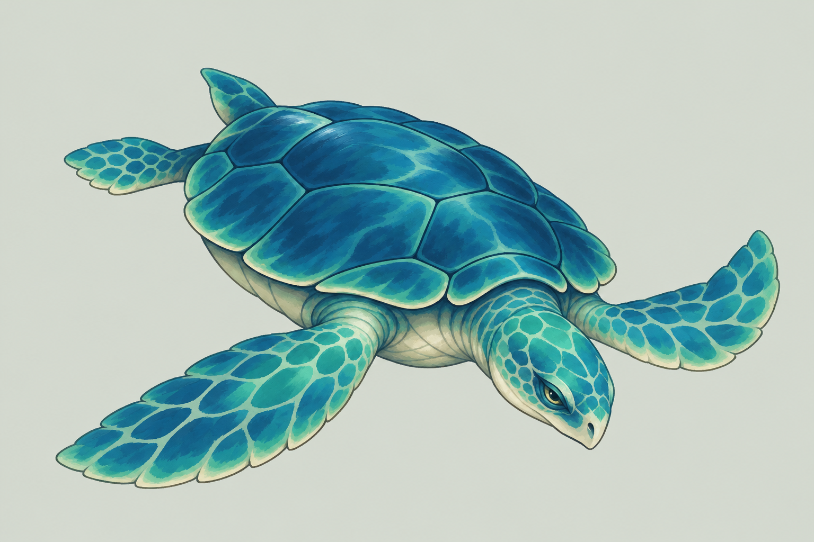
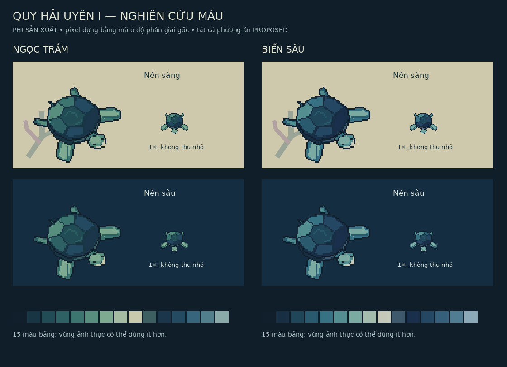

# Task34 Stage A — gói hình Quy Hải Uyên I chờ duyệt

**Bản nghiên cứu R1 được giữ làm lịch sử.** Gói hiện hành theo phản hồi người dùng là [Revision2](TASK34_STAGE_A_REVISION2_REVIEW.md), bổ sung linh tính xuyên ba bậc và số đo native mới; không coi R1 hoặc R2 là hình đã được duyệt.

01/11/2026 (Asia/Saigon). **READY_FOR_USER_REVIEW**, không phải Task34 hoàn tất hoặc StageB được duyệt. Baseline work **b2c84c1943dd22c04e43ed29deed15dd9902ee3b**, worktree sạch trước tạo hình; truy vấn GitHub xác nhận origin/work cùng SHA, main **5ad5678d1fc8b991c0a35d1ffd80f3e816e8624d**. [Audit chính thức](../reviews/POST_TASK33_COMPREHENSIVE_AUDIT.md) ghi TASK34_STAGE_A_READY,0 P0;8 gate P1 cho hình cuối/integration/gameplay, không chặn StageA. Không tái audit01–33.

## Quyền phê duyệt và nguồn

**CONFIRMED:** Quy Sacred Thủy, mai thấp rộng/vững, vây bơi, đầu gọn trầm tĩnh; họ jade/deep-ocean; StageI đơn giản, chừa trần II/III; năm nhóm phản hồi S0. Nguồn: yêu cầu StageA hiện tại, [brief đã cập nhật](QUY_STAGE1_TASK34_HANDOFF.md), [Art Bible](ART_BIBLE_MASTER.md), [creature language](CREATURE_VISUAL_LANGUAGE.md), [scale](PIXEL_DENSITY_AND_SCALE.md), [direction](EIGHT_DIRECTION_ANIMATION_STANDARDS.md), [màu](COLOR_AND_LIGHTING_SYSTEM.md), [QA](ART_QA_CHECKLIST.md), [manifest27](../technical/TASK27_MANIFEST_CONTRACT.md), [renderer28](../technical/TASK28_DIRECTIONAL_ANIMATION.md).

**PROPOSED:** mọi hình mới, palette cụ thể, tỷ lệ, khung và cách chuyển hướng ở gói này. **UNRESOLVED:** phê duyệt hình cuối và phạm vi sản xuất StageB. **SUPERSEDED:** không tạo quyết định thay thế mới; giữ lịch sử nguồn. Hướng kết hợp đã chọn, không hỏi lại ba silhouette cũ. Commit hình không có nghĩa người dùng đã duyệt.

## Hình để duyệt

[Concept minh họa1536×1024](../../assets/concepts/quy-stage1/task34-stage-a/concept-illustration.png) được tạo mới bằng image generation qua ba lượt tạo/chỉnh, chỉ lượt cuối được đưa vào repository. Nền giấy mờ là chủ ý trình bày; ảnh RGB, không transparency của actor. Đây là **minh họa concept**, không pixel-native, không production sprite hoặc nguồn để tự pixelate thành sprite. Mai thấp oval, đầu nêm quan sát, hai vây trước rộng/hai vây sau nhỏ đọc được. Vết vảy và phản quang trong minh họa còn dày hơn pixel study; cần tiết chế khi duyệt StageI, không lấy mọi chi tiết thành yêu cầu sản xuất.

[Hai palette](../../assets/concepts/quy-stage1/task34-stage-a/palette-comparison.png), [silhouette](../../assets/concepts/quy-stage1/task34-stage-a/silhouette-review.png), [so khung](../../assets/concepts/quy-stage1/task34-stage-a/scale-comparison.png), [tám hướng](../../assets/concepts/quy-stage1/task34-stage-a/directional-exploration.png), [ba tư thế](../../assets/concepts/quy-stage1/task34-stage-a/motion-keyposes.png), [bố cục dọc](../../assets/concepts/quy-stage1/task34-stage-a/mobile-layout-study.png) là nghiên cứu pixel/bảng phân tích **dựng bằng mã**. Polygon và mảng màu được rasterize trực tiếp ở kích thước gốc; không đọc/thu nhỏ minh họa. Bảng xem dùng NEAREST2×/3×/4×, có mẫu1× thật. Đây không phải bộ sprite được họa sĩ hoàn thiện từng frame.

## Đánh giá silhouette và giải phẫu

- Bỏ màu/hoa văn vẫn nhận được mai, đầu và bốn vây; đầu/vây trước khác vây sau/đuôi, không rắn/giáp Kim/Thổ.
- Vây rộng là điểm nhận diện tốt nhưng tạo envelope ngang lớn ở góc chéo. Khung64 không đủ cho nhiều tổ hợp hiện tại; không sửa collider hoặc thu cả nhân vật để giấu crop.
- Pixel study còn đơn giản và hơi đối xứng; mặt rất ít pixel, cổ/gốc vây và mặt bên cần họa sĩ tinh chỉnh. Độ đẹp và độ cổ xưa chưa được coi đã đạt chỉ vì silhouette nối thành một khối.
- Tám hướng được dựng lại từ cùng cấu trúc2D có chiếu nén chiều dọc/rim mai; không flip bitmap. Đây là thăm dò góc, chưa model sheet anatomy hoàn chỉnh hoặc8 animation clips. Ánh sáng giữ theo màn hình trên-trái thay vì mirror cả ảnh.

## Hai hướng màu trong cùng họ đã duyệt — PROPOSED

| Phương án | Quan sát trên nền mẫu | Điểm cần duyệt |
| --- | --- | --- |
| Ngọc trầm / jade | Thân/đầu có ngọc xanh ấm hơn, khác nền nước sâu hơn; nền sáng vẫn đọc mai tối | Đề xuất ưu tiên tiếp tục tinh chỉnh phương án này, chưa tự chọn palette cuối |
| Biển sâu / ocean | Mai xanh lam đậm hơn, biểu đạt nước sâu rõ; silhouette ngoài dễ nhập nền tối hơn | Cần tăng phân biệt value ở mép chức năng khi thử scene thật, không bù bằng glow toàn thân |

Mỗi bảng màu tối đa15 màu RGB đục, alpha của native là0/255. HEX thăm dò nằm trong [số đo](../../assets/concepts/quy-stage1/task34-stage-a/study-measurements.json), chưa approved palette. Nền sáng có vài nhánh san hô giả lập; nền sâu là mảng màu kiểm tương phản. Không phải bộ tilemap Hải Uyên hoặc kiểm chứng mọi background production. Không đổi sang họ màu ngoài jade/deep-blue.

## Tệp thực và phân loại

| Nhóm | Tệp đã tạo | Vai trò |
| --- | --- | --- |
| Minh họa | concept-illustration.png |1 ảnh RGB1536×1024, nền trình bày, không runtime |
| Pixel native | pixel-jade-64x64.png, pixel-jade-64x80.png, pixel-ocean-64x64.png, pixel-ocean-64x80.png |4 nghiên cứu S đúng64×64/64×80, RGBA |
| Khung đối chứng | pixel-jade-80x64.png, pixel-jade-80x72.png |2 nghiên cứu cùng thân, chỉ thêm envelope |
| Hướng | direction-n/ne/e/se/s/sw/w/nw-80x80.png |8 tệp tách riêng; ký hiệu slash ở đây mô tả danh sách, không một filename |
| Tư thế | pose-swim-80x80.png, pose-brake-80x80.png |2 key poses SE, chưa animation |
| Silhouette | silhouette-80x80.png |1 mask màu phẳng |
| Bảng xem | palette-comparison.png, scale-comparison.png, directional-exploration.png, silhouette-review.png, motion-keyposes.png, mobile-layout-study.png |6 ảnh RGB có nhãn PHI SẢN XUẤT |
| Nguồn/số đo | build_pixel_studies.py, study-measurements.json, README.md | Tái tạo nghiên cứu, truy vết; JSON không là production manifest |

Tổng **24 PNG** và3 tệp nguồn/ghi chú/số đo trong [thư mục concept](../../assets/concepts/quy-stage1/task34-stage-a/README.md); thêm4 tài liệu Task34 StageA. Không sửa asset reference register để gọi chúng production-ready, không đăng ký manifest/runtime/catalog.

## Validation và giới hạn

Đã mở trực tiếp concept cuối và cả6 bảng xem; kiểm kích thước24 PNG và alpha/màu của17 PNG native (gồm silhouette). Đã chạy generator và kiểm envelope24 trường hợp mỗi khung; chi tiết tại [scale/animation](TASK34_STAGE_A_SCALE_AND_ANIMATION.md).16 ảnh native có màu đạt validator27 bằng fixture trong bộ nhớ:0 error/0 warning; fixture still1000ms chỉ kiểm schema, không timing animation được duyệt. `npm run validate:assets` đạt9 PNG production cũ. Kiểm mới82 liên kết, bảng/fence và git diff --check đạt; cả17 alpha mask liên thông8-neighbor (không thay anatomical art review). Rebuild tái tạo24 PNG cùng hash, concept minh họa không bị script thay đổi.624 tệp tracked và66 PNG cũ giữ nguyên. Không runtime/browser regression mới vì runtime không đổi; kết quả202 Node/38 IndexedDB trong audit là **kế thừa**, không kết quả StageA mới.

Chỉ đảm bảo các tính chất kỹ thuật đã đo; chưa visual production QA, physicalmobile, playback, pixel-perfect occlusion hoặc counterplay. Khoảng tối của silhouette trên nước sâu và anatomy góc chéo còn cần review. Dừng ở [checklist phê duyệt](TASK34_STAGE_A_APPROVAL_CHECKLIST.md); không bắt đầu StageB/Task35.
