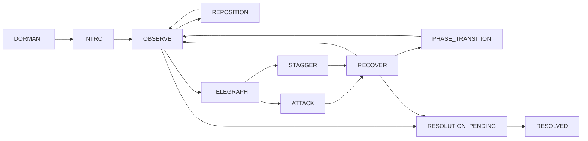

# Boss AI — state recipe, không runtime code

**PROPOSED B23-P06**. [C14 enemy AI](../combat/ENEMY_AI_DESIGN.md), [combat framework](../combat/BOSS_COMBAT_FRAMEWORK.md) và [L16 lifecycle](../loadout/BOSS_LOADOUT_LOCK.md) là authorities. AI state là attempt-local behavior, khác EncounterLockState, combat phase, event completion và biological stage; không bốn enum cùng writer/HP.

Graph hiển thị flow thường, không prerequisite DAG hoặc full interrupt graph. Accepted HP0/outcome/abort có coordinator edge từ mọi active state với guard; không chỉ OBSERVE/RECOVER mới có thể nhận damage/resolve.

| State | Preconditions | Entry/actions | Exit/transitions | Player interaction | Clips | Interrupt | Exploit guard |
| --- | --- | --- | --- | --- | --- | --- | --- |
| DORMANT | Chưa accepted E04 attempt hoặc E04 already resolved khi revisit | Ambient guardian/outcome pose, no hostile casts | Valid entry+lock→INTRO, resolved source→RESOLVED projection | Prep/leave/read clue, no free hit/unique farm trước entry | dormant/watch | Missing content giữ safe prep, no auto entry | Không spawn nhiều actor vì nhìn boss từ route khác |
| INTRO | Attempt/placement/lock boundary accepted trước threat | Brief reveal/source cue, no surprise hit; skip chỉ presentation | Trả control + readiness→OBSERVE | Pause/help/skip, không click skip auto victory | intro/settle | Blur/pending save theo coordinator, không unload unlock | No hostile before control handoff |
| OBSERVE | Active/usable, perceived facts tại accepted cadence | Evaluate range/LOS/source/phase/cooldown/space/counterplay budget, no future inputs | Admissible target pattern→TELEGRAPH; path cần→REPOSITION; outcome→RESOLUTION_PENDING | Có time đọc/get position, không boss perfect counter | watch/turn | Accepted control/outcome via C14 | Không zero-delay fallback hit khi pattern invalid |
| REPOSITION | Path/anchor/turn-envelope valid, không attack committed | Move finite theo body profile, current/collision coordinator | Valid position→OBSERVE, no path→recover/re-evaluate safe | Player move/flank, body không touch damage vô cue | step/turn/reposition | Interrupt/HP0 theo profile, no teleport escape | Không chase ngoài arena hoặc phase body xuyên wall |
| TELEGRAPH | Pattern selected admissible | Startup cue/preview, snapshot aim at visible lock marker | Commit/release→ATTACK; accepted pre-release interrupt→STAGGER/RECOVER; outcome resolving guarded | Đọc cue/đổi lane/optional guard, switch không clear target | Pattern anticipate/aim | No always-stun từ mọi basic; use family budget/profile | No tracking sau lock, no frame-perfect immune reset |
| ATTACK | Cast accepted/source/cost/hit ordinal snapshot | Emit finite shapes/projectiles/field per definition, no renderer hits | Window end→RECOVER, transition queued; source/outcome interrupt by coordinator | Baseline evade by geometry/cover, hit during recovery nếu eligible | contact/release/active | Unreleased windows close on accepted cancel, released effects explicit lifetime | No duplicate hit per target/ordinal qua form switch |
| RECOVER | Pattern resolve/miss/interrupt completed | Thu lực, opening accessible, debt/cooldown giữ | OBSERVE hoặc safe queued PHASE_TRANSITION; outcome→RESOLUTION_PENDING | Chấn Mai guaranteed reachable opening, interact receiver nếu chọn | recover/release/vent_close | Damage accepted, control budget bounded, no immediate cancels | Không cancel recover mỗi frame để chase/brace mãi |
| STAGGER | Explicit C14 control response accepted, not any hit | Finite response/feedback, pending casts xử rule | RECOVER rồi observe, no permanent stun | Optional punish, không requirement phá poise bằng skill chưa mở | stagger/hurt | Family recovery/cap prevents refresh loops | Không reset same control token bằng new form/status |
| PHASE_TRANSITION | Queued predicate + safe boundary/no unsafe old pattern active | Cue mới/pose/source current preview, same body/lock/HP owners | After cue/control-ready→OBSERVE new phase; outcome/HP0 guarded resolve | Di chuyển/đọc cue, không default iframe/heal | phase_shift/settle | Accepted hits/outcome via same pipeline; no resurrect cho phase | No resetting CD/status/phase to mint openings/rewards |
| RESOLUTION_PENDING | Accepted combat/authorized trial proof candidate, stop threat, joint-outcome policy resolved | Close future hostile emission, retire attempt effects theo outcome rules, build E04 write-set | Durable ack + close/placement as L16→RESOLVED; storage fail stay/retry same result | Cosmetic/control theo safe resolution, no equip lách lock before close | yield/recover/cosmetic | No further AI attacks/reward source; no callback conflict priority | No grant/exit/unlock trước durable outcome/close |
| RESOLVED | E04 outcome durable + attempt close boundary handled | Reconstruct unique actor disposition/access, no new first-clear | Ambient/interaction outside attempt, not re-entry duplicate victory | Revisit/G operation quest E05, no boss species capture | resolved/watch/recover | Content/version aliases không reset outcome | Replay intro/action presentation không restart unique reward |

Perception local range/LOS/layer/current/cognition, cadence/numbers chưa approved. Target stable combatantId across form switch, perceived position/time không reserve omniscience; attack commit vector/position không homing bằng input mới. Scheduler bảo toàn one offensive pattern core budget và safe corridor/Quy I counter; không chọn action nếu camera/layout/source không đủ.

Invalid boss placement/navigation bounds: ngừng unsafe attacks, revalidate approved safe recovery/last-good hoặc abort/reset coordinator, không teleport xuyên vách/despawn clone boss để reset HP/reward. Pause/blur không offscreen hits/phase catch-up. Repeat control/hurt/evolution/switch không reset debt. AI không write HP/phase-save/reward/world booleans riêng; C14 owns action/hit/health, E09 status, L16 attempt/lock, W07 source outcome, P15 ledger. Hệ hiện chưa có generic boss AI implemented.
