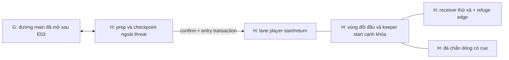

# Arena H và đường vận hành hồi lưu

**PROPOSED B23-P03**, use existing hy_zone_boss H/Thềm Giữ Nước và hy_zone_core G theo [H19 graph](CHAPTER1_WORLD_GRAPH.md)/[area handoff](CHAPTER1_BOSS_AREA_HANDOFF.md). Không new zone/connector/map/tọa độ. Production projection/depth chưa approved; x–y nhìn từ trên xuống là Q18/H19 prototype recommendation dựa runtime, không free3D swim.

Đây là topology nội H, không thêm hy_conn mới. Exit từ arena về prep chỉ sau accepted close/abort/outcome theo [retry](CHAPTER1_BOSS_RETRY_AND_LOCK.md), arrow không cổng tự unlock khi bước ra.

| Thành phần | Spatial contract | Safety/collision/phase |
| --- | --- | --- |
| Prep/checkpoint | Từ gh/G, chỗ đứng rộng nhìn được entry/rút, source anchor valide Quy I/current layer/return | Ngoài hostile volumes/detection; không fauna surprise hoặc auto HP refill; source/cap/snapshot trước entry |
| Player start | Lane mở gần rìa prep, facing tới keeper/landmark, đủ margin hãm | Không trong hit telegraph đang active, no intro hit trước trả control |
| Boss start | Cạnh khóa hồi lưu, nhìn/refuge edge trong scene, không overlap player/receiver | Mỗi retreat/reposition có clearance/turn-envelope, không body contact damage liên tục không cue |
| Main navigation lanes | Lane trái/phải và nơi vòng ra recovery flank/core, reachable bằng Quy I baseline | Tất cả damaging patterns chừa safe response corridor đủ hãm/turn theo input latency target chưa chốt |
| Current channels | Weak ambient cue theo rãnh, attack force vùng finite có preview/expiry | Vector compose với input/action một lần, sweep collision thắng blocked displacement, no wall pin damage ngầm |
| Hazards | Chỉ attack-scoped line/band đã báo, không permanent unavoidable arena-wide pressure | Không mandatory oxygen/depth damage/model nguồn lực mới, no overlapping offensive traps core default |
| Static breakwater | Khối đá chắn một đường pressure theo LOS/material rule, nhìn được tác dụng | Không random destructible/no opaque cover che player; alternate move route luôn có nếu cover không viable |
| Trial receiver/refuge | c1_obj_test_receiver draft là test interface của E03 bypass proof/permission, không E05 restoration van | Quy I CAP_STRUCTURE_OPERATE, tương tác tại safe recovery window, no hold-frame-perfect/new skill; receiver/source immunity không perma ecology harm |
| Recovery space | Pockets có motion-safe margin để định vị và học lỗi | Không đồng nghĩa hồi HP/CD/cleanse hoặc reset attempt khi đứng ở đó |
| Post outcome | H threat dừng theo E04, receiver G được phép thử, đường G/E/B/A còn | Không gi/I hoặc E05 water_stable tự mở; E05/E06 riêng, no forced ChapterII transition |

Mọi attack selection kiểm arena/LOS/camera coverage/safe lane cho **active body phù hợp entry**; nếu pattern không có counter bằng Quy I thì từ chối pattern/reposition, không teleport/invent iframe/cấp loài khác. Large optional evolved Quy cần preflight approach/core envelope/turn/return; không fit thì giữ prep/approved alternate context, no crop/scale/revert stage để vá. New form không bypass entry/state permissions.

Current/collision/source reset giữ base E03/W07 state + attempt transient layer, không restore map bằng replay destructive patches. Relocate player/boss khỏi invalid colliders chỉ bằng approved safe placement/recovery, preserve save và report content gap khi không có anchor. Camera clamp/envelope/culling và telegraph edges phải kiểm màn nhỏ/FX off; không chốt dimensions từ diagram.
