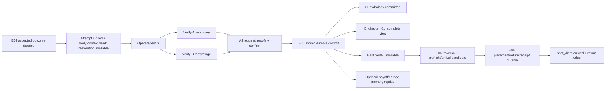

# Finale state machine, source events và rewards

**PROPOSED F24-P01/P10**, reuses [S05 E04–06](../story/STORY_IMPLEMENTATION_HANDOFF.md), [W07](../world/WORLD_STATE_ARCHITECTURE.md)/[transitions](../world/WORLD_STATE_TRANSITIONS.md), [P15](../economy/REWARD_CONSISTENCY.md), [Q21 views](CHAPTER1_QUEST_WORLD_STATES.md), [B23 rewards](CHAPTER1_BOSS_REWARDS_AND_STATES.md). No new permanent finale event IDs/ledger/chapter flags. Same source-version write-set, not cinematic callback authority.

## Conceptual state machine — projections, không saved enum

VA/VB output cùng K nghĩa **AllOf**, không một cái đủ; edge diagram không event IDs mới hoặc cho skip relevant checks. E04 closure source includes E01 parent/E02/E03 facts. P không cạnh vào D/R/T, finale movie/reprise không gate chapter/travel. C/D semantic khác nhưng **same E05 durable unit** theo inherited S05/W07, no transaction split. E06 N khác E05 R.

| Khung nhìn đề xuất | Source/valid transition | Save/load/recovery / duplicate handling |
| --- | --- | --- |
| BOSS_UNRESOLVED | E04 chưa committed hoặc qualification chưa đủ | Existing attempt/last-good rules B23, no fake E04 from HP/UI/loot |
| BOSS_RESOLVED | E04 accepted source/outcome durable, tiếp tới B khi close/body/context safe | Keep actor/outcome/receipt; UI stale rebuild, no boss reset/regrant |
| RESTORATION_AVAILABLE | E04 permission AND close/no active lock + valid body/caps/source/route | Derived from owners; unavailable tạm không rollback E04, recovery/content gates explicit |
| RESTORATION_IN_PROGRESS | Accepted local settings/evidence/intent E05 trước confirm/commit | Local/quest/proof owners lưu khi schema cần, no new saved finale progress enum; restart from missing valid step, no half-patch |
| RESTORATION_COMMITTED | Valid evt_05_restore_water + guaranteed world/receipt write-set | Reconstruct target current/nav/habitat, no effect replay toggles; invalid snapshot recovery |
| FINALE_NARRATIVE_READY | E05 result và eligible presentation/recap context available | Optional ack/cursor presentation only; no new chapter source/reward, missing cosmetic asset fallback |
| CHAPTER_COMPLETED | chapter_01_complete alias valid E05, dependency closure according source version | Same E05 source, not stored independently; no final speech/optional memory/E06 gate |
| NEXT_ROUTE_UNLOCKED | H19 gi/ib/I predicates from E05, travel readiness context riêng | Available ≠ arrived, repeated cue no grant; route_sea_open reserved E06 |
| NEXT_CHAPTER_ARRIVED | E06 completion/placement/return durable | Destination N/same controlled actor, no E07/E08/E11 fact; E05 retained |

## Event/reward ownership map

| Logical source/ID | Preconditions/trigger | World/quest/unlock guarantee | Reward source/category | Replay/load |
| --- | --- | --- | --- | --- |
| evt_04_guardian_conflict | B23 qualifying outcome, actor/refuge/source/attempt validation | E04 actor disposition/mq_04/access permission, close boundary separate L16; no water_stable | grant_evt_04_guardian_conflict existing first-clear, knowledge/access/EXP only approved manifest | Same source once across combat/trial/phase/attempt; after commit no abort/regrant |
| evt_05_restore_water | E04 and source closure + actual operation/outlet/A/B/refuge/coverage/confirm/placement | E05 specified world/nav/current/habitat/quest/critical actor patches atomic; water_stable/refuge_preserved/chapter_01_complete aliases, I available | grant_evt_05_restore_water existing milestone: knowledge/story/access, EXP/resources only approved; chapter unlock **component/view same E05**, not extra chapter completion grant | No FX/dialogue callbacks, no version/new recipient retry; already done reconstruct result/current mutable variant |
| evt_06_surface_route | E05 available route, player actual traversal, destination/return/checkpoint/body/writer valid | Arrival N+return edge/placement+mq_06 source completion, no Phượng body | grant_evt_06_surface_route existing arrival source, no per-return loot/XP | Precommit I, postcommit N; retry/return same source result no duplicate actor/grant |
| S22 optional follow-up sources | Existing opt_01 E02/opt_02 E03/opt_03 E08 and new draft local source conditions | Own optional proof/local patch only, no main E05/E06 rewrite | Legacy/approved source claims incl grant_opt_01_reef_observation, grant_opt_02_ancestral_echo, grant_opt_03_resonance_study remain; no automatic reward from new ecology version | Pre/post variants same canonical claim/recipient set, already-claimed shared component excludes delta |

Source-level unique claim = saveId + canonical event/optional/target scope + reward component, stable grantId tham chiếu nguồn. Recipient allocations `grantId+recipientId` là receipt components trong **one RewardGrantLedger**, source lookup trước recipient dedupe. UniqueRewardClaim chỉ projection/lookup. Source đã committed trả frozen payload/recipients, no thêm recipient do switch/travel/stage hoặc content/schema/payload/title version. One E05 result có C/D/route consumers không ba rewards/source stores. Same source/different payload conflict diagnose, no last callback wins.

Earned species EXP/progression/memory/inventory/entitlement thuộc owners P15/R03/V13, no finale XP/health pool hoặc fullheal/evolve grants không approved. Amounts/drop/recipient split/resources chưa final. Optional curiosity/assist sources không forced peaceful kills, no actor respawn/stare/flow-toggle farm. Reward for chapter closure không tự all bestiary/collectible/optional-mastery completion.

## Atomicity, partial completion và migration

E05 candidate gồm source event/outcome+quest evidence+required properties/route/checkpoint/habitat coverage/critical placement+ledger/all recipients; durable atomic-equivalent commit rồi publish. Local accepted partial settings/proofs khác E05 global completion, no cosmetic actor relocation/collision publish trước candidate valid. Expected **relevant property** revisions/source predicates revalidate, không bắt repeat A/B do unrelated UI/movement revisions. Destructive placement/habitat change unsafe thì defer/reject, preserve last-good/E04/earned facts.

Mất ack lookup receipt, precommit giữ old generation/retry same source, postcommit restore result no grant repeat. Two events cùng update serialize/expected revisions; E04→E05 không auto command do death callback, E05→E06 không auto teleport: actual player action/source/current context/predicates vẫn required. Completed E05 missing UI flag thì rebuild; source record/required predecessor/receipt thật missing thì integrity recovery/backup/quarantine, không fabricate completion hoặc rollback earned progress tùy tiện.

Migration event/quest/zone/anchor/animation/source aliases giữ logical claims/outcomes/recipient scope/version và backup. Future content additions không new old reward identity hoặc invalidate earned chapter source theo extra catalog mới; validate new coverage before activating additions. Unknown newer schema/no mapping giữ safe last-good, no downgrade/xóa save. Storage/atomic adapter/recovery UX/accepted HP/status/lock boundaries còn gates, no full gameplay save implemented ở Task24.
