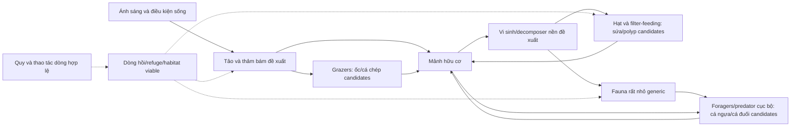

# Mạng thức ăn và dòng năng lượng định tính

**PROPOSED E20-P03**, kế thừa [F06 ecology](../ecology/CREATURE_BEHAVIOR_CLASSIFICATION.md). Không có quan hệ ăn–bị ăn cụ thể nào giữa sáu reference được CONFIRMED từ roster. Đây là fantasy ecology hữu ích cho placement/cue, không mô phỏng sinh học hoặc khẳng định khoa học. Quy có influence lên điều kiện sống, không được mặc định apex predator.

Mũi tên liền là nguồn vật chất/năng lượng giả thuyết, nét đứt là điều kiện habitat, không ăn trực tiếp. Bioluminescence là biểu hiện/cue, không nguồn năng lượng tự nhân vô hạn hoặc resource mới. Không yêu cầu mana feeding, xác rơi loot hay chu trình breeding.

| Nhóm chức năng | Nguồn / output đề xuất | Vai trò và cue người chơi | Hàng rào approval |
| --- | --- | --- | --- |
| Vegetation/thảm bám | Ánh sáng phù hợp/nước/điều kiện sống; organic substrate | Mảng sống còn và nơi grazing; tảo chuyển động theo dòng | Generic environmental concept, không thêm Mộc combat affinity mọi cây |
| Vi sinh phát quang/decomposers | Mảnh hữu cơ trong nước/nền; hạt nguồn cho food chain | Vệt sáng thưa và substrate viable, không bùng particle toàn màn | Background/receiver concept, không species collection mandatory |
| Filter feeders | Sứa pulse drifter, polyp bám nhận hạt trôi | Hiểu dòng phân phối nguồn; khác floating và anchored niche | Cả hai external refs, diet vẫn PROPOSED |
| Grazers | Ốc ở substrate, carp ở rìa tảo/nguồn nhỏ | Dấu ăn/đường đàn cho observation | Không một đối tượng loại bỏ toàn tảo/nguồn của loài khác |
| Scavenger/forager | Đuối dùng mảnh hữu cơ/fauna nhỏ; cá ngựa mồi nhỏ | Vệt cát và nhịp anchor thể hiện niche khác | Chưa nguồn loot/thịt hoặc ăn named species confirmed |
| Predators | Đuối facultative candidate, hoặc generic fauna rất nhỏ chỉ ecological slot | Rình/lượn theo habitat, kiểm soát niche định tính | Không bổ sung named apex species hay boss mandatory |
| Territorial organisms | Không trophic tier; bất kỳ cá thể đủ behavior profile | Warning vì nơi trú/nguồn, không luôn vì đói/evil | Territorial != predator != assimilation |
| Sacred influence | Quy giúp điều kiện cấp/hồi qua interaction có permission | Mở lối nước/refuge, không nuôi/chữa mọi cá thể bằng proximity | Mechanics W07/Q18 proposal, không origin lore mới |

Sau E05 mạng có nhiều đường tiếp cận nguồn hơn nhưng predators còn kiếm ăn, grazers vẫn cần substrate, nơi pressure cao vẫn có tolerance giới hạn. Nếu secondary habitat không đủ food/source/route thì relocation chưa hợp lệ; không “chuyển hết loài vào một refuge” chỉ để tick coverage. Tần suất/khối lượng thức ăn và population không simulation trong first slice. [Relationship matrix](CHAPTER1_SPECIES_RELATIONSHIPS.md) cụ thể hóa các context có thể quan sát, không tự cấp reward.
