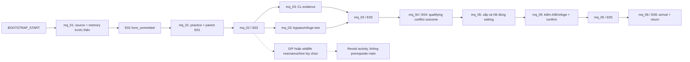

# Dependency graph nhiệm vụ và objective

**PROPOSED Q21-P03**, không world graph mới. [S05 event DAG](../story/STORY_IMPLEMENTATION_HANDOFF.md), [H19 connectivity](CHAPTER1_WORLD_GRAPH.md) và [W07 prior proofs](../world/QUEST_WORLD_STATE_RULES.md) là nguồn. Diagram là view; E01 sub-boundaries và parallel proofs không phải eventId/questId mới.

| Quest | Mandatory predecessor / group | Parallel / optional objectives | Gates / anti-cycle |
| --- | --- | --- | --- |
| mq_01 | BOOTSTRAP_START; memory trước form, practice sau form | b09 replay optional; local steps Task17 reuse | CAP_QUY_MOVE không gate bootstrap; parent không prerequisite sub-grant |
| mq_02 | mq_01 parent E01 complete | Observation/clue proof có thể thu theo thứ tự accessible, encounter phải eligible; D optional | bc không mở chỉ vì đặt thân; không wildlife form/grind required |
| mq_03 | mq_02/E02 complete | CL evidence và khảo sát có thể song song sau entry, bypass test theo available source; optional extra memory không main gate | All proof cần E03 ở E trước eg; no G/F proof cycle, no S2 prerequisite |
| mq_04 | mq_03/E03 complete | Prep/đọc stakes optional presentation; accepted combat outcome hoặc authorized alternative theo Task23 contract | H prep không lock, entry/attempt riêng; no 3-member/optional species gate |
| mq_05 | mq_04/E04 accepted outcome | Vận hành trước kiểm hiệu quả, A/B/refuge checks có thể đi thứ tự thuận route, confirm sau đủ proof | Dùng routes cũ G/E/C/B/A hoặc eb; không gi/I prerequisite trước E05 |
| mq_06 | mq_05/E05 complete | Rest/presentation optional, arrival/return atomic | Quy I tới N, không cần có Phượng trước; return edge không quest loop/reward source mới |

Repeatable feedback/revisit không thêm cạnh ngược vào main DAG hoặc reset COMPLETED. Optional D sau E01 và F theo advanced cap có thể đi ở thời điểm graph cho, không Q2 diagram suggestion tự mở F. Source proof có trước ACTIVE được query/revalidate đúng scope, không tự hoàn predecessor chưa có hoặc bypass access predicates. Concurrent accepted events serialize/expected revision, no callback order authority.
