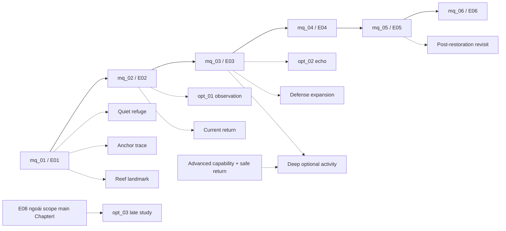

# Side quest–zone matrix và main independence

**PROPOSED S22-P02/P04/P08**, [Task19 graph](CHAPTER1_WORLD_GRAPH.md) vẫn authority13connectors. [Q21 main register](CHAPTER1_MAIN_QUEST_REGISTER.md)/[main DAG](CHAPTER1_QUEST_DEPENDENCY_GRAPH.md) không sửa. Source prerequisites chưa production approved giữ gate; table reachability là conceptual, không navmesh/playtest.

| Quest/activity | Starting zone | Objective zones | Return route | Required movement | Environmental gate | After E05 |
| --- | --- | --- | --- | --- | --- | --- |
| opt_c1_quiet_refuge | hy_zone_reef B | B near niche | ab về A, B safe pocket | Quy I swim/brake/context receiver | E01 parent; niche side source không main object | Adapted verify variant, same source/claim |
| opt_01_reef_observation | hy_zone_reef B | B hoặc hy_zone_habitat D approved equivalent | bd về B, ab/A | Quy I movement/observe, không optional form | E02 done giữ S05; source behavior/catalog/coverage | Secondary/source variant giữ, prior proof eligible |
| opt_02_ancestral_echo | hy_zone_ruins E | E local side source/archive | ce→C→bc→B hoặc eb sau E03 | Quy I structure/read flow | E03 done, source trước/unrelated F; no II/III | Persistent source/archive same memory identity |
| opt_c1_current_return | hy_zone_channels C | C local loop, không new zone | C refuge→bc/B, local return anchor trước completion | Quy I weak-current movement/hãm | E02, weak loop/assets/clearance approved | Already-clear verify/return, no reset panel |
| act_c1_anchor_trace | B hoặc D | D qua bd hoặc B equivalent | bd/B/ab/A | Quy I baseline, source compatible | E01, no named unverified actor production | Variant source/pose, read-only feedback |
| act_c1_reef_landmark | B | B existing landmark | B/A | Quy I basic swim | E01, visible silhouette | Still readable, no regrant note |
| act_c1_return_check | B/I | B, hy_zone_exit I | ib/gi/G/E/B theo H19, no route mới | Quy I move/read flow | E05 done; I không E06 arrival giả | Available post-restoration, no main check ngược |
| act_c1_deep_lane | E safe boundary | hy_zone_trench F | ef/E; fg/G chỉ E03/advanced predicates đủ | Explicit advanced unlocked capability/tolerance/envelope | E03 + H19 ef/fg gates, not StageII alone auto viable | Optional advanced revisit, no unique main source |
| opt_c1_refuge_watch | C/D candidate | C/D refuge scope do author | B/refuge cùng cap, không H arena exit bypass | Quy I baseline intended nếu profile duyệt | E03 + encounter/source/coverage, no main corridor threat | Adapted authorized nonkill/source verify if threat gone |
| opt_03_resonance_study | Approved return source E/B candidate | Hải Uyên source chỉ sau author, không map mới | E06 return rồi old connectors, source cap compatible | Source route approved, không newly promised form prerequisite | E08 existing S05; không early ChapterI relocation | Cross-chapter revisit, eligibility/asset riêng |

Local alcove/panel/shortcut là room-level placement proposals trong B/C/E, không `hy_conn_*` mới tới inaccessible main zones. Nếu geometry/no return invalid thì not ready/defer, không cấp noclip/evolve ability để cứu. Side rewards không author prerequisite/range/mitigation needed cho boss; main capsules/counterplay phải guarantee theo Q21/Task23.

## Dependency diagram — chỉ main→optional

Không cạnh optional→main; M8 là fact S05 ngoài mainline trong diagram này, không hàm ý direct M6→E08 bỏ E07. Optional nodes không prerequisite nhau, không loops side rewards cấp ability cần để mở chính side hoặc boss. Bỏ tất cả optional vẫn giữ M1→M6 và H19 routes. Source proof sớm query đúng prerequisites, không activation marker tự bypass gates. All core collections/memories intended revisit có postE05/E06 source, no deliberately missable unique reward trong portfolio hiện chọn.
