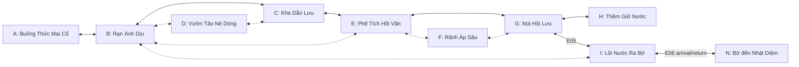

# Đồ thị vùng Hải Uyên

**PROPOSED H19-P03**, nguồn duy nhất cho connectivity Task19; không runtime navmesh. A–I là ký hiệu đọc, IDs trong bảng sau mới là refs. Main path không dùng D/F, không optional species hoặc stage II/III. N là boundary bờ Nhật Diệm, không zone Hải Uyên thứ mười.

Đường nét biểu diễn nhóm tuyến, không thể hiện mọi predicate. Bảng cạnh là điều kiện bắt buộc; hình không cho mở đường sớm.

| Ký hiệu / zoneId | Tên Việt đề xuất | Design region |
| --- | --- | --- |
| A / hy_zone_sanctuary | Buồng Thức Mai Cổ | hy_reg_refuge |
| B / hy_zone_reef | Rạn Ánh Dịu | hy_reg_refuge |
| C / hy_zone_channels | Khe Dẫn Lưu | hy_reg_channels |
| D / hy_zone_habitat | Vườn Tảo Né Dòng | hy_reg_refuge |
| E / hy_zone_ruins | Phế Tích Hồi Văn | hy_reg_channels |
| F / hy_zone_trench | Rãnh Áp Sâu | hy_reg_channels |
| G / hy_zone_core | Nút Hồi Lưu | hy_reg_returns |
| H / hy_zone_boss | Thềm Giữ Nước | hy_reg_returns |
| I / hy_zone_exit | Lối Nước Ra Bờ | hy_reg_returns |

| connectorId | Endpoints | Loại | Access predicate | Năng lực | Return contract |
| --- | --- | --- | --- | --- | --- |
| hy_conn_ab | A ↔ B | Main | E01 practice_complete; local exit valid | Quy I bơi/hãm | Hai chiều sau mở; prebody chỉ Task17 anchors |
| hy_conn_bc | B ↔ C | Main | E02 complete | Quy I movement/read flow đã học | Hai chiều, refuge ở cả hai đầu |
| hy_conn_ce | C ↔ E | Main | E02 complete; lane yếu có route an toàn | Quy I đọc dòng/context receiver I | Hai chiều, không đòi S2 |
| hy_conn_eg | E ↔ G | Main | E03 complete, bypass proof từ E | Quy I thao tác cơ cấu đơn | Hai chiều; G chỉ outer observation trước đó, không E03 cycle |
| hy_conn_gh | G ↔ H | Main | E03 complete | Quy I basic/move/structure theo S05 | Hai chiều ngoài encounter; arena lock riêng |
| hy_conn_gi | G ↔ I | Main sau restoration | E05 complete | Quy I move/read flow | Hai chiều, route exit available; chưa arrival E06 |
| hy_conn_bd | B ↔ D | Optional | E01 complete; refuge route valid | Quy I quan sát/bơi | Hai chiều; không E02 proof shortcut |
| hy_conn_dc | D ↔ C | Optional loop | E02 complete | Quy I movement | Hai chiều; bỏ D không ảnh hưởng main |
| hy_conn_ef | E ↔ F | Optional sâu | Tier II hoặc capability tương đương được author và unlock | Advanced current/pressure tolerance explicit | Hai chiều khi đủ điều kiện; retreat ở cửa, không main reward |
| hy_conn_fg | F ↔ G | Optional shortcut sâu | E03 complete và cùng tier như ef | Advanced capability explicit | Hai chiều; không bypass E03/E04/E05 |
| hy_conn_eb | E ↔ B | Permanent shortcut | E03 complete + local bypass patch hợp lệ | Quy I move | Hai chiều; rút ngắn revisit không thay milestone |
| hy_conn_ib | I ↔ B | Post-restoration shortcut | E05 complete + safe route patch trong E05 | Quy I move | Hai chiều, giữ refuge/habitat |
| hy_conn_in | I ↔ N | Chapter transition | E05 complete, E06 traversal/arrival transaction | Quy I move/read flow; destination valid | Đi E06 trước commit ở I, sau commit ở bờ N có return edge |

## Closure và thứ tự sự kiện

A/E01 → B/E02 → C thực hành current I → E/E03 → G/H/E04 → quay G/E05 và kiểm chứng A/B → I → E06/N. E03 receiver/bằng chứng cần để mở eg đều đặt ở E, không nằm sau chính gate eg. E05 có thể quay A/B qua tuyến cũ trước khi xác nhận; không cần I mở trước để kiểm chứng restoration. Sau E04, gh vẫn cho quay G, boss reward không tự bật gi. E06 available sau E05, nhưng return edge nhat_diem chỉ durable khi arrival E06 hợp lệ.

Các gate dựa story evidence có biểu hiện cơ cấu/nhân vật/nguy cơ cụ thể ở [gates](CHAPTER1_GATES_AND_SHORTCUTS.md), không invisible wall. Optional collection không prerequisite của bất kỳ cạnh main nào. Nếu ability I cần dùng chưa unlock, lesson/grant guaranteed phải đặt trước cạnh và được duyệt, không tự grant từ map. [Zone profiles](CHAPTER1_ZONE_DESIGNS.md) thêm nhiệm vụ/hazard, không sở hữu graph khác.
