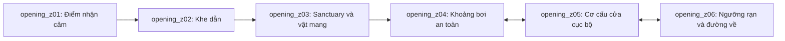

# Bàn giao không gian mở đầu cho Task19

**PROPOSED O17-P07.** Sơ đồ topology ứng viên, không map sản xuất, tọa độ, tile size hoặc asset path. Giữ compatibility với Task19: zoneId cục bộ này có thể map tới khu lớn sau khi duyệt; không tự trở thành canonical region IDs mới.

| Zone / công việc | Landmark, spawn và tiếp cận | Điều kiện thông / yêu cầu Task19 |
| --- | --- | --- |
| opening_z01 | Spawn nhận cảm không có cơ thể; dấu sáng gần trong khung ổn định | Một hành động thành công sớm; không collision spirit tự do |
| opening_z02 | Khe dẫn có đoạn đứt, các anchor nhận cảm nối ngắn | Chỉ tiếp cận vùng hạn chế; cue không chỉ âm hoặc màu; không cần chuyển map thế giới |
| opening_z03 | Vật mang trung tính ở nơi trú; b04/b05 memory; resonance anchor và hậu commit safe body spawn | Kiểm envelope Quy non và route ra trước commit; không dùng cùng tọa độ nhận cảm làm tọa độ thân mặc định |
| opening_z04 | Vùng bơi rộng, mốc đi và vùng hãm đọc rõ | Không damage/oxy/hazard bắt buộc; có chỗ dừng; collision và current cần prototype, không dùng geometry Phượng như đã hỗ trợ nước |
| opening_z05 | Receiver bên cửa, rãnh hồi ngắn, chỗ tựa và quay lại | Một Quy stage đầu + contextual interaction đủ; không yêu cầu nâng vật theo sức mạnh chưa chốt; cơ cấu không đóng nhốt sau khi qua |
| opening_z06 | Ngưỡng thấy rạn, anchor trở về; điểm đọc lại echo cùng nguồn có thể nhìn từ phía cửa | Parent E01 hoàn tất ở safe boundary sau practice; rạn E02 không auto complete; có đường về sanctuary |

B09 là vị trí đọc lại trên tuyến về nguồn/cùng imprint, không memory discovery thứ hai. D03 → D04 là chuyển từ nhận cảm hạn chế sang không gian thân Quy, không xác nhận phép teleport, vật lý sinh thân hoặc độ sâu nước. Placement adapter phải validate hướng, envelope, nền/nước và đường thoát; thất bại thì giữ anchor cũ, không spirit noclip.

Task19 phải xác nhận line of sight, affordance cửa, backtracking, giới hạn current, camera/scale mobile, chỗ đặt checkpoint và route về cho save cũ trước sản xuất map. Không biến lối cửa thành hydrology-restoration toàn vùng; E05 có authority riêng. Asset, âm, light và dòng chỉ là requirements; Task17 không tạo map/art. Xem [cutscene](OPENING_CUTSCENE_REQUIREMENTS.md) cho camera và [save](../technical/OPENING_STATE_AND_SAVE_CONTRACT.md) cho boundary.
