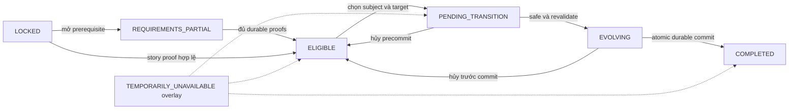

# Luồng trạng thái tiến hóa và giao dịch

**PROPOSED V13-P09**, không code/state-machine implementation. [Decisions](../evolution/TASK13_DECISIONS.md), [loadout contract](../evolution/EVOLUTION_AND_LOADOUT.md), [R03 data](RESONANCE_DATA_MODEL.md) và [W07 save](PERSISTENT_WORLD_DATA_SPEC.md) giữ dependencies. Safe explicit transition là recommendation, chưa được duyệt.

## Tách ba lớp thay vì một enum lưu độc lập

| Suggested state | Có cần không / meaning | Authority / persistence |
| --- | --- | --- |
| LOCKED | View: chưa có prerequisite nền/previous stage/acquisition route phù hợp | Derived từ catalog + progression/records, không saved boolean |
| REQUIREMENTS_PARTIAL | View: track đã biết, requirement bắt buộc còn thiếu | Facts/evidence ở đúng owner R03/W07; view reconstruct |
| ELIGIBLE | View: đủ durable requirement proofs cho target stage | Không authoritative cached flag; cache nếu có phải gắn source revision/content version |
| PENDING_TRANSITION | Intent: người chơi đã chọn subject/target, chờ safe boundary/revalidate | Transition intent có operationId/revision; giữ proofs/reservation refs, chưa grant stage |
| EVOLVING | Presentation/transaction đang thực hiện, có thể trước hoặc sau commit marker | Intent/commit outcome durable, animation cursor không gameplay authority; không resume nửa hit |
| COMPLETED | View/outcome của một target transition đã committed | Existing progression + ledger/commit receipt, không completion boolean store thứ hai |
| TEMPORARILY_UNAVAILABLE | Overlay reason: còn proof/outcome nhưng execution/render/placement chưa phù hợp | Availability context derived; không thay mất ELIGIBLE hoặc COMPLETED |

Bảy labels hữu ích để nói với người chơi nhưng không một chain duy nhất: tạm unavailable có thể phủ nhiều trạng thái; COMPLETED của bước I→II không reset khi đang xét II→III. Có required level/memory đủ ở thứ tự nào cũng được, facts không bị xóa. Current stage chỉ từ CreatureProgression.committedStageId; không copy vào mỗi slot/eligibility record.

Diagram bỏ bớt source validation errors để dễ đọc; bảng transition dưới quyết định semantics. Nút COMPLETED đòi durable commit, không đủ kết thúc animation. Không arrow tự evolution vì level hoặc countdown đã hết.

## Valid transitions / triggers / cancellation

| From → to | Trigger / guards | Cancellation/recovery | Saved effect |
| --- | --- | --- | --- |
| LOCKED → PARTIAL hoặc ELIGIBLE | Acquisition/previous stage đã commit, catalog/gates rõ | Source chưa đủ thì giữ view locked, không bịa stage0 cho Quy | Existing source proof; no evolution reward |
| PARTIAL → ELIGIBLE | Tất cả required durable predicates hợp lệ | Hai events đồng thời hợp nhất theo source revision; no repeated reward | Owner của level/memory/quest/mastery ghi facts |
| ELIGIBLE ↔ unavailable overlay | Combat/lock/nguồn tạm thiếu/asset/clearance | Giữ XP/proof và hint; chờ hoặc quay điểm safe | Thường reconstruct reason, không erase eligibility |
| ELIGIBLE → PENDING | Explicit player request, subjectFormId/toStage/fromStage/version/revision cố định | Duplicate request cùng semantic operation không tạo intent thứ hai | Persist intent; reservation nếu có thuộc owner được duyệt |
| PENDING → EVOLVING | Safe state, source/material/content/assets/module/placement còn hợp lệ | Blocker thì pending/overlay; cancel precommit nhả đúng reservation | Action lock/intent phase, chưa stage grant |
| EVOLVING precommit → ELIGIBLE/PENDING | Cancel/interrupt/storage chưa ack/source đổi | Dựng last committed stage và mọi accepted facts/HP; không heal hoặc consume lại | Aborted/deferred intent, no completion payload |
| EVOLVING → COMPLETED | Revalidate + một atomic bundle durable | Chỉ báo thành công sau acknowledgement | Target stage/config/skill mapping + placement + spend nếu có + receipt/ledger cùng revision |
| EVOLVING postcommit → COMPLETED presentation | Skip/reload/interrupt phần nhìn sau commit | Không rollback/regrant; dựng committed outcome, bỏ/replay cosmetics không effects | No additional grants/costs |
| COMPLETED → next-stage view | Catalog có bước tiếp theo đã approved | Nếu final stage thì không fake endless eligibility | Next view derived, previous completion receipt giữ |

Requirement volatile không được đóng băng thành durable proof. Nếu một durable requirement thật sự đổi qua content update, cần versioned migration/decision trước, không sự kiện thường tự làm mất stage đã hoàn tất. `TEMPORARILY_UNAVAILABLE` không code cho “xóa loài” hoặc “trở về stage I”.

## Logical transaction và duplicate prevention

Một logical commit gồm: operation/transition identity + expected save/catalog/fromStage revision; target committedStageId/config refs; skills/cooldowns/HP/status mappings theo **policy đã approved sau**; safe active placement nếu subject active; material spend/reservation consumption nếu có; unlock receipt/RewardGrantLedger recipient payload; quest/world proof patch nếu transition manifest thực sự cần. Không tự set restored network chỉ vì tiến hóa. Existing W07 writer arbitrate concurrent operations, không animation/UI là writer thứ hai.

Semantic grant key gắn save/species/canonical target-stage hoặc existing awakening grant identity; **contentVersion không tạo reward identity mới**. Same key + same payload là đã xử lý; same key khác payload báo conflict cần review, không grant lần nữa. UnlockRecord là view của ledger/commit outcome, không new reward engine. Nếu alias stage đổi, migration giữ original logical grant identity. Stage I reuse acquisition sub-grant S05; không grant twice từ awakening và evolution cùng event.

Source XP/unlockedSkillIds/knowledge đã durable phải còn dù transition fail; không rollback toàn save về snapshot cũ làm mất accepted damage hoặc XP sau intent. HP/cooldown/status chỉ map theo approved R03/E09 policy, không reset miễn phí. Hai evolution requests hoặc transformation/evolution cạnh tranh cùng subject/placement dùng một transaction arbiter; expected revision mismatch thì re-evaluate, không “last callback wins”.

## Reload, save interruption và browser lifecycle

Save source proof/intent tại acknowledged boundary; không trông chờ tab close/beforeunload làm save duy nhất. Trước commit, load lấy last valid progression + facts; hủy/hoãn intent chưa commit và nhả reservation một lần theo writer. Sau commit, reconstruct target và ledger, không lặp spend/XP/skill grant vì animation chưa hết. Không cần lưu particle/frame từng tick, không offline evolution, không resume nửa combat action.

Lost connection không nhất thiết làm local browser storage fail; nguồn quyết định là storage acknowledgement/integrity/generation, không connectivity flag. Chưa ack thì không tuyên bố durable; giữ last good generation/intent và báo chưa lưu theo UX cần duyệt. Quota/denied/eviction/OS suspend/corruption/backup/storage adapter/loss budget vẫn A08-11/W07-U02, không bảo đảm browser không bị xóa dữ liệu. Không ghi đè namespace settings `nhat-diem.ui.v1`.

Đối với boss, R03 abort/reset hay future resume chưa được Task13 duyệt. Evolution vẫn đề xuất không execute trong attempt; completion/progression đã durable không bị boss retry xóa. Mọi kết hợp resume/HP/status obligations phải chọn contract trước implementation, không tự ghép boss damage cũ với loadout/config mới.
