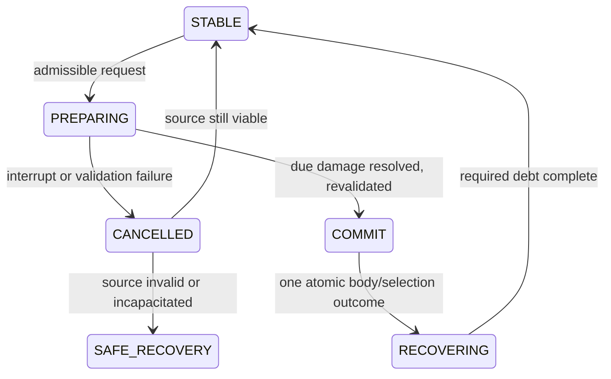

# Loadout state machines và invariants

**PROPOSED L16-P15**: conceptual transitions, not code. Single owners và aliases tại [data](LOADOUT_DATA_SPEC.md); policy ở [switch](../loadout/FORM_SWITCHING_RULES.md), [lock](../loadout/BOSS_LOADOUT_LOCK.md), [entry/retry](../loadout/BOSS_ENTRY_AND_RETRY.md). Đồ thị khác state animation hay metaphysical manifestation, không state copies independently mutable.

## Orthogonal state domains

- Loadout context permissions: SAFE / HOSTILE_RESTRICTED / STORY_RESTRICTED / ENCOUNTER_LOCKED / RECOVERING, derived từ context owners, không flag UI tự set.
- Transition coordinator: STABLE / PREPARING / COMMIT(boundary) / RECOVERING / CANCELLED(outcome), alias R03 TransformationState.
- Boss lifecycle: OUTSIDE_ENCOUNTER / PREPARATION / LOADOUT_CONFIRMED / ENTERING / BOSS_ACTIVE / PLAYER_DEFEATED / RETRY_PENDING / BOSS_DEFEATED / EXITING, views của same EncounterLockState.
- Collection/progression facts persist independent of these contexts; eligibility/readiness projections có revision. State RECOVERING transform khác defeat/checkpoint recovery domain, operation reason phải typed.

## Switch graph và ordered boundary

STABLE + admissible request→PREPARING; protected action request→bounded buffer chưa transaction. PREPARING + due damage→resolve source first; lethal/interruption/stale target/placement fail→CANCELLED→source stable hoặc defeat/world recovery. PREPARING + still valid→atomic COMMIT→RECOVERING(target body)→STABLE. COMMIT không frame người chơi điều khiển/null body, không rollback by cancel. Once committed cost/selection/HP/status receipts stay, playback/resume không replay action.

Command priority: due damage/status/incapacity and context gates → existing action/debt/cancel rules → admissible defense → switch → skill/basic; rendering/notification không authority. Focus/pause clear request buffer, in-flight outcome reconciles committed state; resumed animation không tự switch hoặc heal. Tick rate/same-tick tie/atomic write adapter còn approval, không fixed milliseconds.

SAFE_RECOVERY ở diagram là handoff tới coordinator recovery, không state transform mới được lưu cạnh R03. Buffered request chưa là PREPARING; không nằm trong diagram để tránh hiểu queue là accepted transaction.

## Boss graph, disposition và durable barriers

OUTSIDE_ENCOUNTER→PREPARATION→LOADOUT_CONFIRMED→ENTERING→BOSS_ACTIVE. Pre-start cancel/write fail→PREPARATION, no threats active before durable lock. BOSS_ACTIVE→PLAYER_DEFEATED→EXITING(failed); BOSS_ACTIVE→EXITING(abandoned); BOSS_ACTIVE→BOSS_DEFEATED(resolving)→EXITING(victory). EXITING giữ lock tới valid close/reset/completion/placement ack. Failed close→RETRY_PENDING; victory/abandon close→OUTSIDE_ENCOUNTER. RETRY_PENDING→LOADOUT_CONFIRMED **new attempt** nếu same-team valid, hoặc PREPARATION/OUTSIDE. No ACTIVE→team edit→ACTIVE shortcut.

Guard của BOSS_ACTIVE→PLAYER_DEFEATED là kết quả coordinator xác định không có bất kỳ phương án tiếp tục attempt hợp lệ nào theo health/recovery policy, sau khi đánh giá viable equipped forms và recovery options được policy cho phép; riêng active-form HP0 chưa đủ kết luận. Active-form HP0 trước hết đi qua incapacitation resolution; nếu policy cho phương án tiếp tục hợp lệ thì không tự chuyển sang PLAYER_DEFEATED. Emergency transfer vẫn PROPOSED R03-P07/L16-P07, L16-U05 chưa được chốt; xem [guard lifecycle](../loadout/BOSS_LOADOUT_LOCK.md). Checkpoint recovery sau defeat không được hiểu là resume attempt cũ.

R03/C14 ACTIVE_LOCKED= BOSS_ACTIVE, RESOLVING= BOSS_DEFEATED/EXITING resolution; snapshot immutable config refs, not duplicate live HP. Detail permissions/save/failure each state theo lifecycle matrix [boss lock](../loadout/BOSS_LOADOUT_LOCK.md). Restart/load có unresolved lock: committed completion→reconstruct victory once; otherwise recommended abort/reset/close before repair/edit. Same-team retry doesn't restore old boss partial HP; optional exact resume not chosen.

## Formal implementation-neutral invariants

C = CONFIRMED constraint; P = PROPOSED enforcement/policy; mixed ghi rõ phạm vi. “Usable” activation context khác “eligible admission”; disabled reference có thể retained, không tạo quyền active. Bootstrap và no-control recovery exceptions explicitly modeled, not spirit free-roam loophole.

| ID | Invariant | Status / source |
| --- | --- | --- |
| L16-I01 | canonical member positions ≤3, recommended representation exactly3 explicit empty cells | C max D05/Task16§2; P exact serialization L16-P01 |
| L16-I02 | equip admission ⇒ unlocked ∧ designatedPlayable ∧ operationEligible(sourceRevision) | C unlock/playable distinction R03/Task16; P exact predicate/caps/assets/health policy L16-U02 |
| L16-I03 | embodied controllable ⇒ activeFormId∈equippedUsableMembers and exactly one controlled physical body | C one body/active D05; P min-one/usable predicates, bootstrap/recovery exceptions U01/U05 |
| L16-I04 | empty reserve is not an invalid member or requirement to fabricate unlock | C no forced-three D41; P empty snapshot/validation/package U01/U06 |
| L16-I05 | lock active/resolving ⇒ member identities cannot gain/lose/replace; frozen empties/order immutable if policy selected | C membership lock D06; P full tuple/order/start-end boundaries U06 |
| L16-I06 | active selection may change to eligible frozen member without changing membershipRevision | C switchwithin D06; P action/health/placement gating U04/U05 |
| L16-I07 | species XP/level/skills/mastery/stage owner independent of slots; no slot copies | C D07/Task16§2; P ref/serialization mechanism U09 |
| L16-I08 | switch commit has one source deactivation+target binding outcome, never two controllable bodies | C one physical form; P atomic implementation/runtime/storage U09 |
| L16-I09 | switch/re-entry cannot reset unrelated cooldown, accepted spend or status cursor | P R03/C14/E09/L16-P06; no free heal/iframe default pending scope |
| L16-I10 | load/migration/catalog add cannot silently grant unlock or fake playable species | C explicit Task16 requirement; P alias/quarantine/recovery mechanics U09 |
| L16-I11 | invalid saved membership never resumes control inside invalid placement/lock; preserve owned records | C safe recovery goal Task16; P exact last-good/abort/repair policy U07/U09 |
| L16-I12 | every admitted encounter has viable defeat/exit/checkpoint recovery path; no form prerequisite invented to repair it | C anti-softlock goal/D41; P content/preflight/retry implementation U01/U07 |
| L16-I13 | ordinary new unlock changes collection/progression only, not occupied loadout slot/locked membership | C Task16§18; P source transaction/boundary U09; explicit Quy bootstrap separate |
| L16-I14 | collected set independent of equipped set; equipped eligible subset but collection can exceed3 | C Task16§2; P read-model/cache validation L16-P11 |
| L16-I15 | same logical boss victory grant/outcome applied at most once | C W07/D37/Task16 goal; P writer/receipt/payload idempotency P15/W07 pending |
| L16-I16 | no duplicates by canonical species lineage, stages not extra equipped copies | P R03-P06/L16-U02, not confirmed by repetition |
| L16-I17 | level/skill/evolution evidence can persist during boss, effective stage/config freeze until safe boundary | P V13/C14/P15/L16-U08; D06 alone only membership lock |
| L16-I18 | activeFormId and membership each have exactly one authoritative writer/owner; UI/snapshot/progression refs not mirrored setters | C single-authority technical requirement Task16§23/D39; P adapters/serialization concrete design |

Definitions not runtime-ready until typed refs/eligible policies/cost/clock/animation/geometry/save/approved scope all resolve. New species fixture should satisfy same invariants, not introduce exception branch. Symbolic constraints are not chosen numeric balance/cost/frame values. Future tests reference IDs here, tests have not run.
