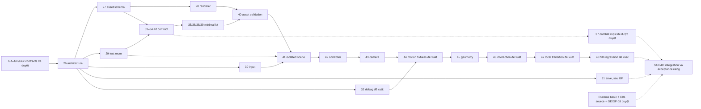

# Phụ thuộc triển khai Tasks26–48

**PROPOSED**: đây là các gói kỹ thuật gắn tạm vào số task để lập kế hoạch. Chỉ các liên hệ được đề bài Task25 chỉ rõ (27asset,28renderer,29map,30input,31save,33–40art,41integration,42–43movement/camera,45geometry) có căn cứ phạm vi hiện tại; chưa có toàn bộ đề bài26–48/49. Khi đề bài thật khác, reconcile lịch trước thực hiện, không coi bảng là tên/phạm vi chính thức đã được duyệt.

## Lịch và đầu ra nghiệm thu tương lai

| Task | Gói công việc dự kiến | Phụ thuộc / gate | Đầu ra và giới hạn |
| --- | --- | --- | --- |
| 26 | Kiến trúc scene/actor contracts và adapter cũ | GA–GD theo subset được duyệt | Điểm thay runtime sớm nhất **dự kiến**, chỉ khi đề bài26 cho phép; Dawn mặc định không đổi |
| 27 | Manifest/asset validation | 26contract, GG | Paths/rect/anchors/required clip errors; không tự tạo art |
| 28 | Renderer adapter | 26/27, GB/GG | Vẽ actor theo manifest, giữ tile/Dawn screenshot regression |
| 29 | Map test-room descriptor | 26, GB/GC/GG | Nước/solid/anchors/current bounds cô lập; không full9zones |
| 30 | Semantic input và teardown | 26, GB/GC | Swim/brake/interact + keyboard/touch/blur contract, không đổi phím Phượng ngầm |
| 31 | Save foundation theo scope được duyệt | 26/GD/GF; GE nếu có HP | Candidate/last-good/memory receipt/migration; không gate bắt buộc của S0 |
| 32 | Debug/observability, gán số đề xuất | 26contract | Kiểm refs/anchors/bounds/current/errors; chưa có debug UI này trong code |
| 33 | Art brief và nguồn, gán chi tiết đề xuất | GG/GB,27contract | Model/anatomy/provenance/scale được duyệt trước export |
| 34 | QuyI sprite/manifest contract, gán chi tiết đề xuất | 33/27,GB/GD/GG | Anchor/footprint/directions; Q05/B+C nếu làm awakening |
| 35 | Idle/swim directions, đề xuất | 34 | Clips hợp giải phẫu; mirror chỉ nếu được duyệt |
| 36 | Turn/brake/interact, đề xuất | 34/GC | Tư thế/bao hình đúng motion; không giả marker từ idle |
| 37 | Basic combat/Water/brace clips theo cut, đề xuất | 34,GE/GG và C14 subset | Basic phục vụ S1; Water/brace chỉ khi scope riêng duyệt, không chặn S0 |
| 38 | Terrain dưới nước tối thiểu, đề xuất | 29/33/27 | Solid/passable/readability, không overwrite Dawn |
| 39 | Current/receiver/landmark cues, đề xuất | 29/33/GC | Một flow và một receiver, low-FX vẫn đọc được |
| 40 | Kiểm asset tích hợp tối thiểu, đề xuất | 27/35/36/38/39,28 | Runtime-compatible S0 kit; kiểm37 riêng khi S1 cần combat, không buộc full bộ art |
| 41 | Tích hợp scene Quy cô lập | 28/29/30/40,GA–GD/GG; GF nếu durable | Actor/map/input bind đồng bộ; lỗi asset giữ tuyến cũ, không default Quy |
| 42 | Controller bơi/current | 41,GC, fixture geometry29 | Compose motion một lần, capped/current/brake; thử blockout trước final polish nếu duyệt |
| 43 | Camera/movement feedback | 41/42,GB/GG | Envelope/clamp/viewport, cue dòng trong khung; không gắn offset Phượng |
| 44 | Gói đối soát motion/debug trước geometry, gán số đề xuất | 32/42/43 | Sweep/bounds fixtures và sai lệch motion-vs-sprite; chờ đề bài44 thực tế |
| 45 | Collision/geometry integration | 29/42/43/44 | Solid/corners/turn/current bounds/return và Dawn không hồi quy |
| 46 | Receiver + objective trong phiên, gán số đề xuất | 41/45/39 | Một interaction có before/after/proof tạm, không fake E05 hoặc species reward |
| 47 | Restart/chuyển cảnh local an toàn, gán số đề xuất | 41/45/46 | Unbind/load/rebind/clear input và return fixture; không cross-chapter E06 |
| 48 | Regression/build và checkpoint S0, gán số đề xuất | 27/40/42/43/45/46/47 | Nghiệm thu demo movement; không chứng nhận D40 nếu thiếu combat/resonance/durable progress |

Gói hoàn thiện S1/D40 còn cần runtime action/basic combat, source E01 và durable integration cùng31/37; việc gán chúng vào task49 hoặc task cụ thể khác chờ đề bài. Trước49 phải có acceptance rõ để không báo S0 là D40 hoàn chỉnh. Không ép boss GI, E02 đầy đủ GH hoặc ending GJ vào minimum slice.

Graph không có vòng; mũi tên vào một node là các phụ thuộc cần đủ, không phải chọn một. 29 có fixture policy tối thiểu để thử42 trước khi45 kiểm toàn diện; không tạo vòng42↔45. Basic renderer có thể thử approved blockout trước final40, nhưng41 acceptance production cần kit phù hợp.

Có thể làm song song27schema,29descriptor,30input,32diagnostics sau contracts;31 save sau GF là lane riêng; art35/36 và38/39 sau source/semantic contracts có thể song song. Đây là khả năng lập kế hoạch, không yêu cầu agent song song hoặc thực thi task ngay. Shared file/hook integration cần review riêng, tránh nhiều task sửa cùng core mà thiếu adapter contract.
