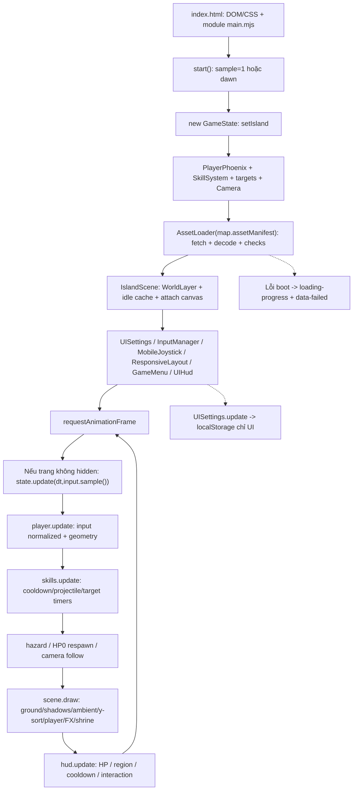

# Luồng thực thi Phoenix/Dawn hiện tại

Bằng chứng baseline Task25 xem [audit repository](TASK25_REPOSITORY_AUDIT.md). Luồng sau được đọc từ mã và đối chiếu browser build local; không phải kiến trúc Quy đã triển khai.

## Entry và thứ tự tạo trạng thái

[index.html](../../index.html) dòng264 tải `src/island/main.mjs?v=8` bằng module. [main.start](../../src/island/main.mjs) dòng10–24 tạo GameState **trước** khi tải asset. URL chỉ kiểm `sample=1`, không có tuyến Quy hoặc router. [islands](../../src/island/islands.mjs) dựng eager cả hai map khi import; default FIRST_ISLAND là dawn. [GameState.setIsland](../../src/island/GameState.mjs) dòng14–29 tạo player Phượng mới, skill mới, target HP mới, shrine tắt và camera mới.

AssetLoader đọc manifest mà map chỉ định; entry không dùng fallback manifest cũ mặc định của loader. IslandScene nhận terrain/props/phoenix và metadata, tạo tile renderer, tạo cache idle trong Canvas rồi attach canvas hiển thị. Sau đó gắn input/layout/menu/HUD; khi thành công mới ẩn loading và công bố `window.IslandGame` với snapshot/ready/view/settings.

## Đồng hồ và side effect

| Chủ sở hữu | State / side effect thực | Ranh giới tương lai cần giữ |
| --- | --- | --- |
| main | rAF, last timestamp; dt cap0.05; visibility reset last | Không dùng rAF/animation callback làm event/reward authority |
| GameState | time, paused, message; player/skills/targets/camera/shrine; use/interact | Không biến shrine toggle thành quest completion hoặc restoration |
| PlayerPhoenix | x/y/facing, HP/regen/invulnerability/recovery, animation | Không coi policy Phượng là HP/manifestation Quy |
| SkillSystem | cooldown, projectile/effects, nextId và target damage | Chưa có combatant/source ledger hoặc atomic reward |
| InputManager và pointer controls | keys/pad/hover; event có thể gọi attack/fire/interact ngay ngoài update | Cần arbitration/input gating khi có cast/scene transaction; clear không thay durable facts |
| Camera/ResponsiveLayout | follow/clamp, integer scale, canvas size, CSS control placement | Camera biểu diễn hình, không sở hữu world progression |
| IslandScene/WorldLayer | drawCount, idleCache; drawImage/FX trên Canvas | Visual bounds/hitbox/persistent world là các trách nhiệm khác nhau |
| UISettings/GameMenu | localStorage UI, dialog/pause, normalized control positions | Không dùng key settings cho game save; không đụng farm key |

`GameState.update` ngừng khi paused; main không gọi update/draw/HUD khi hidden. Blur xóa held input nhưng không tự đặt paused; do đó trang visible nhưng mất focus vẫn có thể chạy timer/regen/projectile. Không tuyên bố đây là pause policy Quy đã duyệt. InputManager.action chặn paused/document.hidden; direct keydown và queued effects cần được kiểm riêng ở scope tương lai.

## Chuyển scene và lưu

Chuyển `?sample=1` là tải trang mới; không phải giao dịch chuyển vùng bền vững. `setIsland()` không có loader/rebind view/layout/input trọn vẹn: gọi riêng hàm này trên state có thể để scene còn map cũ và mất state player/skill/shrine. Hiện public API không expose setIsland. Không có save gameplay trong luồng này; snapshot chỉ tạo object phục vụ quan sát, settings là ghi bền vững duy nhất của active entry.

Đề xuất: giữ nguyên luồng Dawn; chỉ thêm adapter/scene bootstrap cô lập sau [gate A–D](TASK25_DECISION_GATES.md). Teardown listener/resource và preload lỗi cần hợp đồng trước scene switch thật; E06 actor placement/return/save thuộc giai đoạn sau, không do setIsland mặc định thực hiện.
