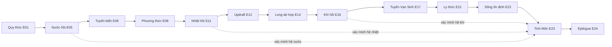

# Dependency graph của world events

**PROPOSED — W07:** đặc tả tương lai, chưa triển khai hoặc tự phê duyệt các đề xuất Task 02–06. Ràng buộc CONFIRMED xem [PROJECT_DECISIONS](../PROJECT_DECISIONS.md).

Đây là projection của [24 event contracts Task05](../story/STORY_IMPLEMENTATION_HANDOFF.md), không danh sách event mới. Event IDs/completion ở nguồn truyện; bảng này sở hữu cách đánh giá dependency/unlock an toàn. Main graph là chuỗi acyclic; E23 còn kiểm bốn stable predicates từ các predecessor trước đó.

## Graph đầy đủ để handoff

Các supporting events trong cột cuối chỉ cung cấp thông tin/biến thể/reward riêng, **không main prerequisite**. `none` không có nghĩa có thể skip predecessor.

| Event ID | Required earlier events | Resulting unlock / proof | Optional supporting events |
| --- | --- | --- | --- |
| `evt_01_quy_awakes` | BOOTSTRAP_START | Quy có thân, practice xong | none |
| `evt_02_read_reef` | evt_01_quy_awakes | Đọc rạn/journal | none |
| `evt_03_trace_returns` | evt_02_read_reef | Bypass nước sẵn | opt_02_ancestral_echo |
| `evt_04_guardian_conflict` | evt_03_trace_returns | Giải quyết guardian, chưa phục hồi mạng | none |
| `evt_05_restore_water` | evt_04_guardian_conflict | water_stable, surface entry available | none |
| `evt_06_surface_route` | evt_05_restore_water | Đến Nhật Diệm, return edge biển | none |
| `evt_07_survey_basalt` | evt_06_surface_route | Điều kiện địa nhiệt được khảo sát | opt_04_thermal_habitat |
| `evt_08_phuong_awakes` | evt_07_survey_basalt | Phượng có thân, practice xong | none |
| `evt_09_thermal_evidence` | evt_08_phuong_awakes | Bằng chứng nhiệt, heat bypass | opt_03_resonance_study |
| `evt_10_protect_outlets` | evt_09_thermal_evidence | Conflict outlet kết thúc | none |
| `evt_11_restore_heat` | evt_10_protect_outlets | heat_stable, updraft entry available | none |
| `evt_12_thermal_ascent` | evt_11_restore_heat | Đến Phong Vân, landing/return edge | none |
| `evt_13_air_routes` | evt_12_thermal_ascent | Các air nodes tiếp cận được bằng dạng cũ | none |
| `evt_14_synchronize_long` | evt_13_air_routes | Tái hợp resonance Long, practice xong | none |
| `evt_15_network_conflict` | evt_14_synchronize_long | Conflict quyền kiểm soát khí kết thúc | none |
| `evt_16_restore_wind` | evt_15_network_conflict | wind_stable, living corridor entry available | opt_05_wind_challenge / opt_06_cloud_archive |
| `evt_17_living_corridor` | evt_16_restore_wind | Đến Vạn Sinh, return edge khí | none |
| `evt_18_map_relationships` | evt_17_living_corridor | Nhu cầu và refuge adapted được ghi | none |
| `evt_19_restore_partners` | evt_18_map_relationships | Nối partners bằng dạng cũ | opt_07_adapted_garden |
| `evt_20_ecological_confrontation` | evt_19_restore_partners | Conflict sinh thái giải quyết, không extermination | none |
| `evt_21_ly_awakes` | evt_20_ecological_confrontation | Ly có thân từ mạng sống, practice xong | none |
| `evt_22_stabilize_life` | evt_21_ly_awakes | life_stable, habitat adapted viable | none |
| `evt_23_activate_gate` | evt_22_stabilize_life + evt_05_restore_water + evt_11_restore_heat + evt_16_restore_wind | gate_active, không sang planet mới | none |
| `evt_24_local_epilogue` | evt_23_activate_gate | arc_complete, tiếp tục exploration | opt_08_rebalance_garden sau E22 |

## Conflicts và recovery theo nhóm

| Nhóm | Xung đột phải chặn | Recovery an toàn |
| --- | --- | --- |
| E01/E08/E14/E21 | Dùng dạng mới để mở chính nó; form grant bị lặp | Entry bằng capabilities cũ/bootstrap; form_committed cấp một lần rồi practice tiếp |
| E04/E10/E15/E20 | Boss thắng bị coi là mạng ổn ngay | Outcome proof lưu riêng; main restoration E05/E11/E16/E22 xác minh sau |
| E05/E11/E16/E22 | Optional variant/weather/faction phủ nhận milestone | Stable predicates đơn điệu; mutable branch chỉ trong guardrails |
| E06/E12/E17 | Đòi arrival flag trước khi cho đi; lưu giữa hai vùng | Entry enabled từ restoration trước; intent source trước commit, destination + return/checkpoint sau commit |
| E13/E19 | Cần Long/Ly trước khi thức | Node/partner access bằng dạng đã có và receiver, main training bảo đảm |
| E23/E24 | Đòi equip cả bốn/III hoặc optional memories; kích hoạt planet chưa làm | Kiểm bốn hệ đã lưu + E22, không kiểm bốn slots; giữ tại Vạn Sinh và đường hồi |
| Optional ecology | Dependency vòng qua main hoặc vô hiệu collection | Chỉ cạnh từ main ra optional; variant không xóa main facts, rollback variant an toàn |

Mỗi row dùng transition/reward/save contract chung; prerequisite thất bại không mutate, retry sau điều kiện đủ. Không còn cycle main: mọi required event có index nhỏ hơn event đang xét. Awakening subgraph source_validated → form_committed → practice_complete cũng acyclic. E01 không đòi CAP_QUY_MOVE ở entry. Không cài thêm rarity/evolution/faction/optional-species gate ẩn.

## Unlock available khác đã đi qua

Surface available = E05, traversed/arrived = E06; updraft available = E11, traversed = E12; living corridor available = E16, traversed = E17. `route_*_open` Task05 ở transition completion biểu thị tuyến đã được ghi nhận đi-về, không khóa entry trước đó. ChapterProgressState công bố cả entryAvailable và arrived. Main progress không dùng animation cue hoặc scene loaded thay arrival transaction.
